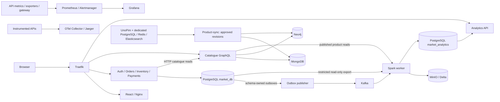

# Market Hardware V3

A local e-commerce and data engineering platform for computer hardware. GitHub stores the code, contracts and synthetic seed data; Docker runs the application and databases on your machine.

The [V3 requirements](docs/MARKET_HARDWARE_CAHIER_DES_CHARGES_V3.md) define the target. See the [compliance matrix](docs/phase8-compliance-matrix.md) for implemented and outstanding requirements. AI/PC Builder (Phase 7), automatic invoice PDFs and confirmation-email workers remain unfinished. Payments are simulated; this deployment uses local loopback HTTP.

## Features

- On `3d-test-branch`: [one continuous pastel 3D city](docs/3d-world.md) with Commercial, Industrial, Logistics and Business districts, plus the [original storefront demo](frontend/README-3D.md). Desktop browsers only; live recorded state and optional DEMO pedestrians/vehicles are explicitly distinguished.
- UnoPim authoring, explicit approval and versioned publication to MongoDB, with validated compatibility relationships in Neo4j.
- React storefront and role-protected administration: catalogue, orders, inventory, analytics, observability and alerts.
- Auth, Orders, Inventory and Payments REST services; catalogue GraphQL; durable checkout Saga, stock reservations, refunds and transactional outboxes.
- Kafka publication after broker acknowledgement; Spark Structured Streaming, Delta Lake on MinIO, analytics serving data and quarterly batch reports.
- Persistent business alerts, warehouse utilization, Prometheus/Grafana monitoring, OpenTelemetry/Jaeger tracing and technical-log retention.
- Tracked seed data, additive SQL migrations and backup/recovery tooling. Existing-installation test results do not prove a fresh-clone installation works.

## Architecture



Business schemas have separate logins; cross-service operations use HTTP. Analytics source export is an explicit restricted read-only exception documented in the [ADRs](docs/ADR/). UnoPim does not write directly to commerce tables. Monitoring is separate from the business data flow.

## Technology stack

| Area | Implementation |
| --- | --- |
| UI / gateway | React, TypeScript, Vite, Nginx, Traefik 3.5 |
| APIs / authentication | Python 3.12, FastAPI, Strawberry GraphQL, Argon2id, JWT |
| Operational stores | PostgreSQL 16, MongoDB 7, Neo4j 5.26 Community |
| PIM | Digest-pinned UnoPim, dedicated PostgreSQL, Redis, Elasticsearch, Mailpit |
| Events | Apache Kafka 4.1.2, KRaft, transactional outbox |
| Analytics | Spark 3.5.7, Delta Spark 3.3.2, MinIO S3, separate analytics database |
| Operations | Prometheus, Grafana, Alertmanager, OpenTelemetry Collector, Jaeger, exporters |
| Initialization | PowerShell, Python/psycopg, checksum-verified SQL migrations, CSV/JSON/JSONL fixtures |

Exact inputs are in [Compose](docker-compose.yml), its [UnoPim include](infrastructure/unopim/compose.yaml), Dockerfiles and dependency locks. Some base image tags and host development dependencies remain floating; installation is not guaranteed byte-for-byte identical over time.

## Prerequisites

- Windows, PowerShell 5.1+, Git and **Python 3.12** (`py -3.12` or `python`).
- Docker Desktop running **Linux containers** with its WSL2 backend and virtualization configured. Compose must support `include` (2.20+).
- Planning estimate for the full stack: **16 GB host RAM, preferably 24-32 GB; 10-12 GB available to Docker when possible; 4 CPU cores; 40 GB free disk** before data/backups grow. These are recommendations, not a measured cold-start minimum. Spark has a 2.5 GB container limit; Neo4j and Elasticsearch also consume JVM memory.
- Internet access for images, Python/npm packages, the pinned MinIO source build and Spark JARs. First builds can take considerable time.
- Host Node.js/npm is needed only for frontend development/browser tests; host Java 17 only for host Spark execution. The documented Docker startup supplies Node, Java, PHP and Go inside builds/containers.
- Free loopback ports: `3000, 5432, 6379, 7474, 7687, 8000, 8025, 8080, 9000, 9001, 9090, 9092, 9093, 16686, 27017`.

## Quick Start: first installation

Read [Cold Start](docs/COLD_START.md) before running these stages. Copying `.env.example` alone is insufficient: it contains placeholders and blank credentials generated by later provisioning.

On a machine with **no Market Hardware containers or volumes**:

```powershell
git clone https://github.com/youb04980498-code/market-hardware.git
cd market-hardware
Copy-Item .env.example .env
powershell -NoProfile -ExecutionPolicy Bypass -File .\scripts\prepare-cold-start.ps1
powershell -NoProfile -ExecutionPolicy Bypass -File .\scripts\install-market.ps1 -SkipPackages -SkipContainers
powershell -NoProfile -ExecutionPolicy Bypass -File .\scripts\start-market.ps1 -WithKafka
.\.venv\Scripts\python.exe data/seeds/phase2.py all
if ($LASTEXITCODE -ne 0) { throw 'Database initialization failed' }
powershell -NoProfile -ExecutionPolicy Bypass -File .\scripts\start-catalog.ps1
powershell -NoProfile -ExecutionPolicy Bypass -File .\scripts\start-commerce.ps1 -WithKafka
foreach ($topic in @('market.auth.v1','market.orders.v1','market.inventory.v1','market.payments.v1')) {
    docker compose exec -T kafka /opt/kafka/bin/kafka-topics.sh --bootstrap-server localhost:19092 --create --if-not-exists --topic $topic --partitions 1 --replication-factor 1
    if ($LASTEXITCODE -ne 0) { throw "Topic initialization failed: $topic" }
}
powershell -NoProfile -ExecutionPolicy Bypass -File .\scripts\start-analytics.ps1
powershell -NoProfile -ExecutionPolicy Bypass -File .\scripts\start-platform.ps1
```

Run stages separately and stop at the first error; interactive PowerShell does not automatically stop after a failed native command. Create a human UnoPim admin separately using the interactive command in [Cold Start](docs/COLD_START.md#5-create-a-human-pim-administrator). Generated commerce credentials are saved directly in ignored `.env`.

**This complete cold-start sequence has not been executed against an empty isolated stack.** Existing-stack readiness is separate evidence. See [validation status](docs/COLD_START.md#validation-status-and-known-limitations).

## Start an existing installation

Keep the original root `.env`, `infrastructure/unopim/.env`, `.venv` and volumes:

```powershell
powershell -NoProfile -ExecutionPolicy Bypass -File .\scripts\start-platform.ps1
powershell -NoProfile -ExecutionPolicy Bypass -File .\scripts\verify-platform.ps1
```

This applies additive operations/analytics setup and starts all implemented profiles without reseeding business data. It assumes database initialization, PIM integration, service accounts and `KAFKA_ENABLED=1` already exist. Never copy the example over an existing `.env`, regenerate passwords for populated volumes or routinely reseed during restart.

## Local access and accounts

| Interface | Address | Account source |
| --- | --- | --- |
| Storefront / administration | [Storefront](http://localhost:8080/) / [Admin](http://localhost:8080/admin) | `DEV_CUSTOMER_*` / `DEV_ADMIN_*` in root `.env` |
| UnoPim | [PIM admin](http://localhost:8000/admin) | Human admin created interactively; integration robot is separate |
| REST Swagger / OpenAPI | `http://localhost:8080/api/<service>/docs` / `openapi.json` | Services: `auth`, `orders`, `inventory`, `payments`, `analytics` |
| Catalogue | [GraphQL](http://localhost:8080/graphql) | Published reads; catalogue operations require staff/admin |
| Grafana | [Grafana](http://localhost:3000) | `admin`, `GRAFANA_ADMIN_PASSWORD` |
| Prometheus / Alertmanager | [Prometheus](http://localhost:9090) / [Alertmanager](http://localhost:9093) | Local development interfaces |
| Traces | [Jaeger](http://localhost:16686) | Local development interface |
| Neo4j | [Browser](http://localhost:7474), Bolt `127.0.0.1:7687` | `neo4j`, `NEO4J_PASSWORD` |
| MinIO | [Console](http://localhost:9001), S3 `127.0.0.1:9000` | `MINIO_ROOT_USER` / `MINIO_ROOT_PASSWORD` |
| PostgreSQL / MongoDB | `127.0.0.1:5432` / `127.0.0.1:27017` | Root `.env`; applications use restricted accounts |
| Mailpit | [Mailpit](http://localhost:8025) | Captured local PIM mail; commerce email worker unfinished |

Commerce provisioning creates separate admin/customer/second-customer accounts, retaining existing passwords. Historical disabled seed accounts cannot log in. `UNOPIM_*` credentials belong to product-sync, not a human admin. A fresh clone contains no `.local/LOCAL-ACCESS.md` or another machine's private credential notes.

## Verification

```powershell
docker compose config --quiet
docker compose --profile catalog --profile commerce --profile streaming --profile analytics --profile frontend --profile monitoring ps -a
powershell -NoProfile -ExecutionPolicy Bypass -File .\scripts\verify-market.ps1
powershell -NoProfile -ExecutionPolicy Bypass -File .\scripts\verify-platform.ps1
.\.venv\Scripts\python.exe scripts/check-contracts.py
```

`verify-market` checks store authentication, required infrastructure Docker health and persistent mounts. `verify-platform` checks frontend HTTP, catalogue readiness, monitoring endpoints and nonempty/all-up Prometheus targets. Neither proves a completed checkout, full seed import or initial Spark output. Use the read-only checks in [Cold Start](docs/COLD_START.md#8-verify-initialization).

The `verify-data`, `verify-catalog`, `verify-commerce`, `verify-frontend` and `verify-analytics` scripts run integration/browser tests. They can create retained records, pause workers or exercise recovery. Full test campaigns are separate from basic startup.

## Troubleshooting

| Symptom | Action |
| --- | --- |
| Docker stopped / WSL failure | Start Docker Desktop, confirm Linux containers with `docker info`, resolve WSL2/virtualization before continuing. |
| Port conflict | Inspect `Get-NetTCPConnection -State Listen`; stop the conflicting application. Port changes require auditing scripts, routes and UnoPim's fixed Host header. |
| Missing environment / blank credentials | New install: prepare before Compose, then provision in order. Existing install: recover original ignored files; do not replace secrets. |
| Unhealthy container | Inspect `docker compose ps -a` and `docker compose logs --tail 100 <service>`; fix the first failing dependency. Keep credential-bearing logs private. |
| UnoPim initialization/login fails | Allow migrations/indexing to finish; inspect its PostgreSQL/Elasticsearch dependencies. `/up` does not prove an admin exists. Never run `unopim:install` as repair: it invokes `migrate:fresh`. |
| Empty catalogue / missing PIM counters | Check Phase 2 import, PIM integration, approvals and `product-sync`. Staff metrics also require Auth. |
| Spark delayed / empty charts | Check all four topics, `KAFKA_ENABLED=1`, MinIO and worker logs. Initial source refresh precedes streaming. Seed dates may fall outside today's dashboard range. |
| JVM killed / build fails | Check Docker memory/disk; allow resources for Spark, Elasticsearch and Neo4j. First MinIO compilation/JAR downloads take time. |
| PowerShell policy blocks scripts | Use the shown per-process `-ExecutionPolicy Bypass`; no permanent machine policy change is required. |

## Safe stop and restart

```powershell
docker compose --profile catalog --profile commerce --profile streaming --profile analytics --profile frontend --profile monitoring --profile world stop -t 60
powershell -NoProfile -ExecutionPolicy Bypass -File .\scripts\start-platform.ps1
```

`stop` retains containers and volumes. `down` removes selected containers/networks but retains named volumes by default. Never add `-v`/`--volumes`, prune volumes or reset Docker Desktop to repair startup: those actions can destroy databases, PIM storage, Kafka offsets and lakehouse checkpoints. See [backup/recovery](docs/phase8-backup-recovery.md).

## Repository layout

```text
data/                 fixtures, contracts, SQL migrations, Mongo/Neo4j schemas, seeds
market_catalog/       PIM adapter, approved publication, GraphQL, operations status
market_commerce/      Auth, Orders, Inventory, Payments, Saga, outbox, retention
market_analytics/     Spark/Delta pipelines, serving API and alerts
services/             API entry points and container dependencies
workers/              worker entry points and documentation
pipelines/            analytics image, pinned Spark JARs and pipeline documentation
frontend/             React storefront/admin, Nginx, browser tests
infrastructure/       Compose include, gateway, monitoring, tracing, MinIO build
scripts/              Windows setup/start/verification and backup tooling
tests/                automated unit, integration, acceptance and recovery checks
docs/                 requirements, ADRs, implementation reports and evidence
```

PostgreSQL schemas are defined in `data/postgres/schema/migrations/`: four business schemas `auth`, `orders`, `inventory`, `payments`, plus technical `monitoring` in `market_db`. Analytics uses separate `market_analytics` and migrations under `data/analytics/`.

## Further documentation

- [Fresh installation](docs/COLD_START.md), [development conventions](AGENTS.md).
- [Database mappings](docs/phase2-database-setup.md), [PIM/catalogue](docs/phase3-catalogue.md), [commerce/Saga](docs/phase4-commerce.md), [frontend](docs/phase5-frontend.md).
- [Analytics architecture](docs/phase6-analytics.md), [observability](docs/phase8-observability.md), [backup/recovery](docs/phase8-backup-recovery.md).
- [EFREI assignment](docs/EFREI-assignment.md), [compliance matrix](docs/phase8-compliance-matrix.md), [recorded Phase 8 results](docs/phase8-final-report.md), [jury demonstrations](docs/phase8-jury-demo.md).
- [Historical V1 architecture](docs/architecture/MARKET_HARDWARE_ARCHITECTURE.md): V3 and implementation ADRs take precedence.
