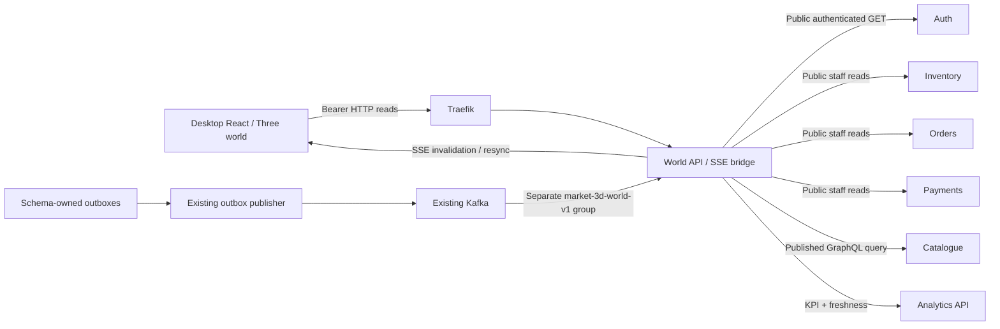
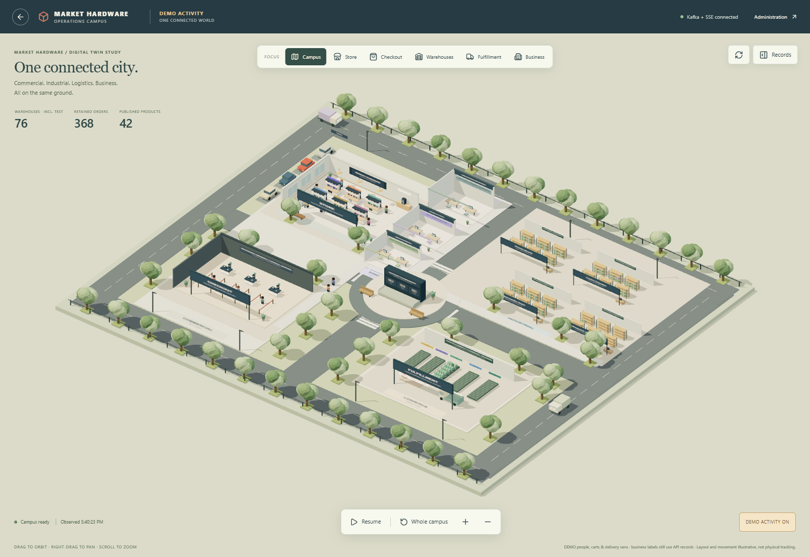
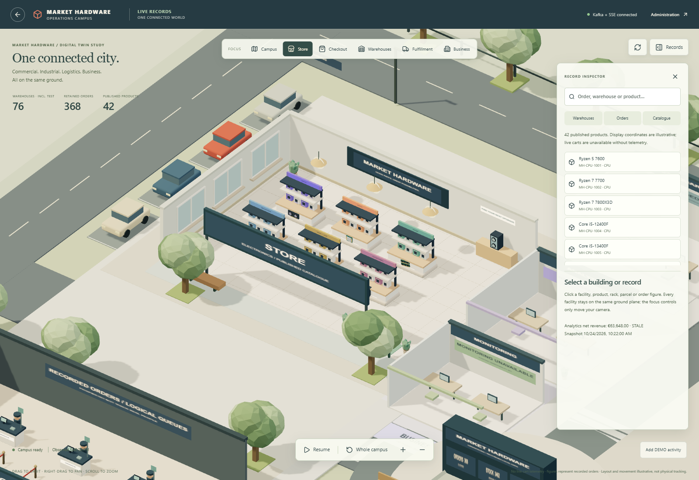

# Market Hardware — recorded-data 3D world

This desktop experiment lives exclusively on **`3d-test-branch`**. No merge into `main` is implied.

- **Live read model:** http://127.0.0.1:5173/admin/3d-world (Vite), or http://localhost:8080/admin/3d-world (Docker frontend).
- **Original standalone DEMO:** `/admin/3d-store`; preserved with synthetic shoppers/carts.
- **API documentation:** http://localhost:8080/api/world/docs.

Use the existing administrator/staff account. Local credentials remain in ignored `.env`; none are embedded in the frontend or URLs. PC browsers at **1280px and above** are the only supported layout target.

## One miniature city, four districts

| Environment | Recorded data | Illustrative representation |
| --- | --- | --- |
| Operations overview | Warehouse count, retained order total, published product total, analytics KPI/freshness | Clickable world destinations and synthetic geography |
| Store/checkout | Up to eight anonymous figures labeled by recorded order ID/status; catalogue department/product details | Existing cutaway store, logical checkout/exit positions; no tracked humans |
| Industrial district | All actual warehouse records, city, classification and quantity summaries; TEST records opt-in | Up to five recorded warehouse buildings on the same plane; selecting another record replaces an annex, never invents another warehouse |
| Warehouse interior | Current physical/reserved/available quantities from Inventory | Synthetic racks and SKU boxes; one box represents a SKU stock row, not one physical unit |
| Fulfillment | Latest order window, payment states, exact order lookup | Parcels and status lanes; observed status changes move a parcel toward its latest recorded stage; SHIPPED parcels enter an illustrative open vehicle bed |
| Business district | Retained order/product totals, Analytics revenue/freshness and optional observability reads | Clickable virtual headquarters, analytics and monitoring offices; these are illustrative buildings, not physical company locations |

Commercial contains the electronics fixtures and a separate checkout hall. Industrial holds recorded warehouses; Logistics holds fulfillment and delivery. Business connects headquarters, analytics and monitoring. Campus and surrounding buildings share a procedural architecture kit with glazed façades, industrial bays, parapets, skylights and roof equipment. Overview shows complete buildings; camera focus opens the relevant roof/front walls to reveal retained interactive fixtures. Pastel district paving, sidewalks, tree-lined roads, parking, benches and a central board connect every facility on **one ground plane**. One persistent WebGL canvas renders the world. Focus buttons and clickable buildings smoothly move the camera; they never swap scenes or graphics contexts. Reduced-motion preference uses immediate camera positioning.

LIVE means the **local application's recorded data**, including retained fixtures and test history. It is not a feed of real shoppers or physical operations. Cart/session telemetry is unavailable. The optional **Add DEMO activity** toggle adds simulated browsing/cart/queue characters, outdoor pedestrians and two circulating delivery vans. Their motion is decorative and explicitly labeled DEMO; business figures continue to use APIs. The original standalone DEMO route remains available. No new fulfillment, payment or inventory commands are provided.

Click buildings, figures, SKU boxes, racks or parcels. Search/filter the record lists; choose a status; look up an exact order ID outside the recent window. Details link to existing order administration, inventory, catalogue, analytics and observability pages. Left drag orbits, right drag pans and scrolling zooms. Pause freezes **animation only**; HTTP reconciliation continues. Reduced-motion preference starts paused. Camera controls use damping. Reset returns to the whole city.

## Architecture and ownership



The world service receives **no SQL/MongoDB/Neo4j credentials**. It composes public HTTP reads, not private database joins. New reads owned by existing services:

- `GET /api/inventory/warehouses/{id}/stock?page=1&page_size=100`: staff-only, paginated Inventory-schema read; no fabricated location field.
- `GET /api/payments/states?order_ids=1,2`: staff-only, at most 100 positive IDs; Payments-schema read; provider remains simulated.

World endpoints: `/api/world/snapshot`, `/api/world/warehouses/{id}/stock`, `/api/world/orders/{id}`, `/api/world/monitoring`, `/api/world/events`, `/api/world/health`, Swagger and OpenAPI. Monitoring reads the existing Analytics observability endpoint independently so unavailable monitoring cannot block core snapshots. All data/stream endpoints require active staff/admin authorization; health exposes only process/consumer diagnostics. Contracts are tracked under `data/contracts/openapi/`. [ADR 0008](ADR/0008-readonly-3d-world.md) records reliability and ownership choices.

## Existing installation: start

Keep original environments and volumes. Ensure the platform has already completed Phase 2/3/4/6 provisioning and that `KAFKA_ENABLED=1` was selected with the existing `start-commerce.ps1 -WithKafka` path.

```powershell
cd C:\market-hardware
git switch 3d-test-branch
powershell -NoProfile -ExecutionPolicy Bypass -File .\scripts\start-world.ps1 -WithFrontend
powershell -NoProfile -ExecutionPolicy Bypass -File .\scripts\verify-world.ps1
```

This builds the existing commerce image containing the two additive reads, starts existing stores/read APIs/commerce workers/Kafka/analytics serving API, creates missing existing topic names with `--if-not-exists`, builds/starts the optional world service and reloads the gateway. `-WithFrontend` builds/starts the existing Nginx frontend. No seeding, database migration, credential rotation, offset reset, volume deletion or Spark restart occurs. **Existing commerce workers can resume pending work**, exactly as under normal commerce startup.

For Vite instead, omit `-WithFrontend` and run:

```powershell
cd C:\market-hardware\frontend
npm ci
npm run dev
```

The same port 5173 and API proxy are reused. The world itself adds no frontend dependency beyond those already installed for the first prototype. Python uses the existing pinned commerce dependencies. The Docker image runs one Uvicorn worker and one consumer thread as an unprivileged user.

Analytics can be read while its Spark writer is stopped; its snapshot is explicitly marked STALE. For fresh materialized analytics, use the existing `start-analytics.ps1` procedure separately. The 3D service does not run or replace Spark consumers.

## New installation / cold start

A clone alone does not contain databases, credentials, PIM configuration or Kafka history. On a new machine **without any Market Hardware containers/volumes**:

```powershell
git clone --branch 3d-test-branch https://github.com/youb04980498-code/market-hardware.git
cd market-hardware
Copy-Item .env.example .env
powershell -NoProfile -ExecutionPolicy Bypass -File .\scripts\prepare-cold-start.ps1
powershell -NoProfile -ExecutionPolicy Bypass -File .\scripts\install-market.ps1 -SkipPackages -SkipContainers
powershell -NoProfile -ExecutionPolicy Bypass -File .\scripts\start-market.ps1 -WithKafka
.\.venv\Scripts\python.exe data/seeds/phase2.py all
if ($LASTEXITCODE -ne 0) { throw 'Database initialization failed' }
powershell -NoProfile -ExecutionPolicy Bypass -File .\scripts\start-catalog.ps1
powershell -NoProfile -ExecutionPolicy Bypass -File .\scripts\start-commerce.ps1 -WithKafka
foreach ($topic in @('market.auth.v1','market.orders.v1','market.inventory.v1','market.payments.v1')) {
    docker compose exec -T kafka /opt/kafka/bin/kafka-topics.sh --bootstrap-server localhost:19092 --create --if-not-exists --topic $topic --partitions 1 --replication-factor 1
    if ($LASTEXITCODE -ne 0) { throw 'Kafka topic initialization failed' }
}
powershell -NoProfile -ExecutionPolicy Bypass -File .\scripts\start-analytics.ps1
powershell -NoProfile -ExecutionPolicy Bypass -File .\scripts\start-world.ps1 -WithFrontend
```

Run stages separately and stop on the first error. Follow [COLD_START.md](COLD_START.md) for prerequisites, human UnoPim admin creation, data mappings and recovery; do not clone a second time if already following this sequence. The world adds no database, migration, role, bucket or seed dataset. **This complete empty-volume cold-start sequence has not been executed.** Existing-installation validation is separate evidence and cannot prove new-machine boot.

## Configuration

To stop only the bridge, retain all volumes and leave commerce running:

```powershell
docker compose --profile world stop world
```

Restart with `start-world.ps1`. The [root safe-stop command](../README.md#safe-stop-and-restart) includes the optional world profile when stopping the entire platform. Never use volume deletion or consumer-offset reset as a reconnect fix.

| Variable | Default | Meaning |
| --- | --- | --- |
| `WORLD_KAFKA_ENABLED` | `1` | Consume existing topics. With `0`, HTTP reads still work but the UI reports Kafka unavailable/reconciliation. |
| `WORLD_KAFKA_GROUP` | `market-3d-world-v1` | Dedicated group; must start `market-3d-`. Never reuse an analytics/other business group. |

Compose supplies internal `AUTH_URL`, `INVENTORY_URL`, `ORDERS_URL`, `PAYMENTS_URL`, `CATALOG_URL`, `ANALYTICS_URL`, `KAFKA_BOOTSTRAP_SERVERS` and the existing OTel endpoint. Defaults work with existing `.env`; optional values are documented in `.env.example`. No new secret is required. Keep Auth/API root secrets out of the world container. Do not expose Kafka to the browser or put JWTs in query strings.

## Event flow, reconnects and limitations

1. Existing transactions write their schema-owned outboxes. The unchanged publisher sends existing `market.orders.v1`, `market.inventory.v1`, `market.payments.v1` records after broker acknowledgement.
2. The world consumer validates minimal envelope fields, suppresses recently identical IDs and increments an invalidation generation. Conflicts and older events request fresh reads; their payloads never override API state. Poison records are counted/rejected without applying business state, then acknowledged to avoid permanently blocking a partition. There is no new durable dead-letter queue.
3. Offsets commit synchronously **after** processing/rejection, with automatic commits/offset storage disabled. On failure/restart the consumer rejoins its own group. No existing group offsets or Spark checkpoints are touched.
4. Bearer-authenticated SSE emits sanitized resync/invalidation/heartbeat diagnostics. Every new/reconnected stream forces an HTTP snapshot; streams recheck Auth every ten seconds and rotate at about sixty seconds. The client has a 25-second heartbeat watchdog, offline detection, bounded reconnect backoff and coalesced serialized reads.
5. Fifteen-second HTTP reconciliation also catches catalogue updates, lost notifications and changes without events. Browser pause affects only animation, not data reads. Missing sources remain unavailable, and retained data is marked stale rather than replaced by zeros.

The bridge is disposable, single-process and not a durable historical replay product. Its bounded 4096-ID dedup cache may permit extra harmless refreshes after eviction/restart. HTTP composition is not an atomic distributed snapshot. Latest 100 orders and first 100 published products are loaded; exact order lookup retrieves older IDs; stock pages contain up to 100 rows. Rendering caps: five warehouse buildings, 24 SKU objects per warehouse, 24 parcels, eight live order figures or eleven demo people and two demo vans. All warehouse records remain selectable, including explicitly marked TEST records. Instanced cuboids/foliage, zoom-sensitive label LOD, capped DPR, demand rendering when paused and selective state-transition animation bound the graphics work. No new asset or frontend dependency is introduced for the city; geometry and lettering are procedural.

Recorded states do not prove physical packing, shelf coordinates, shipment GPS or customer presence. No server-side cart telemetry, physical tracking, fulfillment mutation API, multiplayer, physics or AI agent was added. Payments remain the existing simulated provider. Normal desktop GPU performance has not been benchmarked; browser automation uses Chromium software WebGL. The existing Three/Fiber clock deprecation and large lazy 3D bundle warnings remain known dependency/build limitations.

## Verification and screenshots

```powershell
powershell -NoProfile -ExecutionPolicy Bypass -File .\scripts\verify-world.ps1
.\.venv\Scripts\python.exe -m pytest tests/integration/test_world_recovery.py -m recovery -q
cd frontend
npm run typecheck
npm run lint
npm test
npm run build
$env:FRONTEND_URL='http://127.0.0.1:5173'
$env:FRONTEND_JUNIT_FILE='../.local/world-browser.xml'
npx playwright test tests/world.spec.ts tests/store3d.spec.ts
```

Run broker recovery, commerce and browser checks serially. The explicit recovery test stops/restores Kafka in `finally`; it verifies HTTP reads remain authoritative during broker loss. The world read suite fingerprints business tables before/after API/SSE reads and performs no business writes. Existing checkout/inventory regression tests separately use retained isolated verification orders/warehouses and are not actions exposed by the 3D UI.

Execution results are recorded after final verification below. Local JUnit reports: `.local/world-backend.xml`, `.local/world-recovery.xml`, `.local/world-commerce-regression.xml`, `.local/world-browser.xml`. Browser captures are under `.local/screenshots/3d-world/`; selected sanitized images are tracked under `docs/images/`.

### Executed on 2026-10-24

The results below cover the original connected-city implementation. The later surrounding-city scenery update and campus architecture rebuild were production-built and visually previewed but **not regression-tested**, at the user's request. Their independent procedural geometry was inspired by [Gaurav-Gosain/city](https://github.com/Gaurav-Gosain/city); no upstream code/assets were copied because no reuse license was found in the inspected repository. Existing screenshots below predate those updates; the latest campus image is in `frontend/README-WORLD.md`.

- TypeScript, ESLint and production Vite build passed; all **40 frontend unit tests** passed.
- **16 world backend checks** passed against running services, including unchanged business fingerprints, staff authorization, owned API comparisons, actual Kafka consumption and SSE resynchronization.
- **One actual Kafka outage/recovery test** passed; the broker was restored and the existing bridge rejoined.
- **Four existing commerce regressions** passed: successful checkout/server pricing, non-reserving cart validation, idempotency conflicts and last-unit concurrency. Their isolated retained verification records remain separate from source fixtures.
- **Two city browser tests** passed against the rebuilt Docker frontend on port 8080: repeated focus changes preserve the same canvas, API totals match, warehouse/product/order and Business details work, DEMO is labeled, offline/reconnect recovers, desktop widths fit, no serious/critical accessibility violations were found, and no commerce writes or browser page errors were observed. The original store's three browser tests also passed.
- Docker frontend and world images were rebuilt and became healthy. Kafka, Auth, Inventory, Orders, Payments, catalogue, Analytics serving and required stores were running healthy at verification. Analytics was explicitly STALE; monitoring sources were unavailable. Fresh Spark processing and complete monitoring readiness are not claimed.
- OpenAPI export comparison, Ruff and Compose validation passed. No local secret values were found in changed/new Git candidates. V3 requirements, migrations and source seed data remain unchanged.

Initial checks exposed a click-handler wiring error, a long software-rendering timeout and a selector that incorrectly expected a header without its nested subtitle. These were corrected; final checks above passed. No empty-volume bootstrap or desktop GPU frame-rate benchmark was performed. The large Three.js lazy chunk warning and existing dependency deprecation warnings remain.




