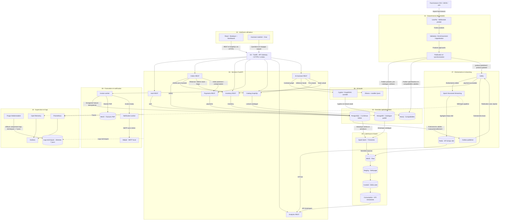

# MARKET HARDWARE — Cahier des charges technique (V3)

**Statut :** spécification cible, à implémenter et à valider  
**Déploiement :** local, Docker Compose, composants gratuits et auto-hébergeables  
**Périmètre :** plateforme e-commerce de matériel informatique, PIM, graphe de compatibilité, assistant LLM, traitements batch et streaming, supervision.

> Les composants et garanties ci-dessous sont des **exigences**, et non une affirmation qu'ils sont déjà opérationnels. Les exigences marquées **MUST** sont obligatoires pour l'acceptation du projet.

## 1. Objectifs et périmètre

La plateforme doit :

1. Commercialiser un catalogue de composants informatiques, avec consultation des produits, panier, commandes, paiement simulé et suivi logistique.
2. Administrer les fiches produits dans un **PIM**, puis publier une version validée dans MongoDB et les relations techniques pertinentes dans Neo4j.
3. Fournir des **API REST et GraphQL fonctionnelles**, documentées et testées.
4. Appliquer des règles métier en base et au niveau applicatif, avec gestion des transactions, réservations, idempotence et événements fiables.
5. Calculer des indicateurs **temps réel** (Kafka + Spark Structured Streaming) et **trimestriels** (Spark batch).
6. Conserver durablement les ventes, commandes, acheteurs, paiements et factures, sous réserve des règles légales de conservation et de suppression.
7. Enregistrer les logs techniques et **purger chaque semaine les logs techniques âgés de plus de 7 jours**, sans effacer les données commerciales ni les traces d'audit financier.
8. Générer une facture PDF après confirmation d'un paiement réussi et émettre un email de confirmation via un serveur SMTP local de test.
9. Offrir un assistant LLM local capable d'expliquer les compatibilités matérielles à partir de relations vérifiées, sans accès SQL libre aux bases transactionnelles.

## 2. Architecture logique verticale



**Principe de propriété :** UnoPim est la source de vérité des descriptions et attributs produits ; MongoDB en est la projection de lecture ; Neo4j est la projection des compatibilités **validées** ; PostgreSQL est la source de vérité des commandes, stocks, acheteurs, paiements et factures. Les données de stock ne sont pas éditées dans le PIM. Les prix au moment de l'achat sont figés dans les lignes de commande.

## 3. Composition technique

| Domaine | Technologies cibles | Fonction |
|---|---|---|
| Frontend | React, TypeScript, Vite, Tailwind | Boutique et tableau de bord |
| API | Python 3.12, FastAPI, Strawberry GraphQL | REST et GraphQL |
| Gateway | Traefik | Routage, contrôle d'accès, limites |
| Transactionnel | PostgreSQL | Transactions, contraintes, outbox |
| Catalogue publié | MongoDB | Documents produits flexibles |
| PIM | UnoPim, base propre au PIM | Création, validation, publication |
| Graphe | Neo4j Community | Relations de compatibilité |
| LLM | Ollama + modèle Qwen compatible avec les conditions de licence retenues | Inférence locale |
| Événements | Apache Kafka | Bus d'événements métier |
| Streaming / Batch | Apache Spark / PySpark | Temps réel et calculs trimestriels |
| Lakehouse | MinIO + Delta Lake / Parquet | Raw, staging, curated, consumption |
| Cache analytique | Redis | KPI temps réel |
| Factures | ReportLab, MinIO | PDFs et archivage |
| Emails | Mailpit | Simulation SMTP locale |
| Supervision | OpenTelemetry, Prometheus, Grafana | Traces, métriques, tableaux de bord |
| Déploiement | Docker Compose, volumes persistants | Exécution locale |
| Tests | pytest, Playwright, tests d'intégration | Vérification des exigences |

Les éditions, versions et licences exactes doivent être verrouillées dans le dépôt. L'absence de coûts de licence ne garantit pas l'absence de contraintes de ressources matérielles.

## 4. Modèle de données — PostgreSQL

**Exactement quatre schémas métier** dans `market_db` : `orders`, `inventory`, `payments`, `auth`. Une table de logs peut être placée dans un schéma technique séparé `monitoring` : ce dernier **ne constitue pas un cinquième schéma métier**. Les tables techniques de l'outbox appartiennent au schéma métier qui émet les événements, ou à une infrastructure dédiée si le contrat est documenté.

### 4.1 `orders`

| Table | Champs principaux | Contraintes et finalité |
|---|---|---|
| `customers` | `customer_id`, `first_name`, `last_name`, `email`, `created_at` | PK ; email unique et non nul |
| `orders` | `order_id`, `customer_id`, `status`, `total_cents`, `created_at`, `updated_at` | FK client ; montant >= 0 ; statut contrôlé |
| `order_items` | `order_item_id`, `order_id`, `product_id`, `quantity`, `unit_price_cents` | FK commande ; quantité > 0 ; prix >= 0 ; unicité `(order_id, product_id)` |
| `outbox_events` | `event_id`, `event_type`, `event_version`, `aggregate_id`, `payload`, `occurred_at`, `published_at` | UUID unique ; émission fiable |

`product_id` fait référence **logiquement** au produit MongoDB/PIM : aucune FK PostgreSQL inter-base n'est possible. Validation par API avant validation de la commande.

### 4.2 `inventory`

| Table | Champs principaux | Contraintes et finalité |
|---|---|---|
| `warehouses` | `warehouse_id`, `name`, `city`, `capacity_units` | Capacité >= 0 |
| `stock` | `product_id`, `warehouse_id`, `quantity`, `reserved_quantity` | PK composée ; quantités >= 0 ; réservations <= quantité ; FK entrepôt |
| `reservations` | `reservation_id`, `order_id`, `product_id`, `warehouse_id`, `quantity`, `status` | Quantité > 0 ; statut contrôlé ; FK stock ; unicité métier |

Le stock disponible vaut `quantity - reserved_quantity`. Une réservation doit être atomique et sûre en cas de requêtes concurrentes (verrouillage ou mise à jour conditionnelle).

### 4.3 `payments`

| Table | Champs principaux | Contraintes et finalité |
|---|---|---|
| `payments` | `payment_id`, `order_id`, `amount_cents`, `status`, `method`, `idempotency_key`, `created_at` | Montant >= 0 ; clé d'idempotence unique ; transitions contrôlées |
| `invoices` | `invoice_id`, `order_id`, `payment_id`, `invoice_number`, `issued_at`, `total_cents`, `pdf_object_key`, `status` | Numéro unique ; **une facture par paiement éligible** ; référence de PDF |
| `notification_deliveries` | `delivery_id`, `invoice_id`, `recipient`, `status`, `attempts`, `last_error`, `sent_at` | Suivi des tentatives et reprise |

Les références `order_id` sont logiques entre schémas/services : la politique de dépendance doit respecter l'autonomie des services. Aucun stockage de données de carte bancaire sensibles.

### 4.4 `auth`

| Table | Champs principaux | Contraintes et finalité |
|---|---|---|
| `users` | `user_id`, `username`, `password_hash`, `is_active`, `created_at` | Identifiant unique ; mot de passe haché |
| `roles` | `role_id`, `name` | Rôle unique |
| `user_roles` | `user_id`, `role_id` | PK composée ; FK utilisateurs et rôles |

**Exigence :** comptes de services avec permissions minimales ; aucune API métier ne doit recevoir un accès administrateur global.

### 4.5 Logs techniques : `monitoring`

Table recommandée : `monitoring.application_logs` avec `log_id`, `created_at`, `service_name`, `level`, `request_id`, `trace_id`, `method`, `path`, `status_code`, `duration_ms`, `message`, `metadata_json`.

- Les logs ne doivent pas contenir de mots de passe, jetons, données de carte ou informations personnelles non nécessaires.
- Index sur `created_at`, `service_name`, `trace_id` ; partitionnement temporel recommandé.
- La **purge hebdomadaire** supprime uniquement les logs techniques âgés de plus de **7 jours** au moment de l'exécution.
- Les historiques de commande, acheteurs, paiements, factures et pistes d'audit financier **ne doivent pas être supprimés par cette purge**.
- L'ordonnanceur peut être un conteneur dédié avec cron ; l'exécution doit produire un bilan `start/end/count/status`.

Exemple de purge ciblée :

```sql
DELETE FROM monitoring.application_logs
WHERE created_at < NOW() - INTERVAL '7 days';
```

La fréquence hebdomadaire implique que certains logs peuvent être conservés jusqu'à environ 14 jours entre deux passages ; si une **durée maximale stricte de 7 jours** est requise, une purge quotidienne est nécessaire. Le contrat retenu ici est **exécution hebdomadaire avec seuil d'âge de 7 jours**.

## 5. Catalogue MongoDB et PIM

**Base :** `market_catalog` ; **collection :** `products`.

```json
{
  "product_id": 101,
  "sku": "GPU-101",
  "name": "Example GPU",
  "category": "GPU",
  "brand": "Example Brand",
  "price_cents": 34900,
  "currency": "EUR",
  "attributes": { "vram_gb": 12, "interface": "PCIe" },
  "active": true,
  "source_version": 4,
  "published_at": "2026-10-23T10:00:00Z"
}
```

Exiger : `product_id` stable, `sku` unique, catégorie autorisée, prix >= 0, devise explicite, validation des attributs selon catégorie, version de publication et index de recherche. Pour les validateurs BSON, les identifiants et prix doivent être écrits en **Int64 BSON** de manière cohérente.

Le PIM gère la préparation et la validation ; seul le service de synchronisation publie dans MongoDB/Neo4j. Les échecs de synchronisation doivent être rejouables, idempotents et visibles dans les logs. La base interne du PIM est indépendante de `market_db`.

## 6. Neo4j, assistant LLM et configurateur PC sous budget — obligatoires

### 6.1 Cas d'usage principal

**MUST :** l'utilisateur peut demander en langage naturel : « Compose un PC gaming complet, compatible, disponible et à moins de 1 200 €, pour jouer en 1440p, avec 32 Go de RAM ». Le système retourne une nomenclature (BOM) complète, un total exact, le budget restant, des preuves de compatibilité et les compromis retenus. Les budgets, usages et préférences sont paramétrables. Si aucune configuration validée ne respecte les contraintes, le système le dit et propose des ajustements explicites ; il ne fabrique pas de résultat.

### 6.2 Graphe de connaissance et règles techniques

- Nœuds : `Product`, `CPU`, `Motherboard`, `Socket`, `Chipset`, `BIOSVersion`, `RAM`, `MemoryType`, `GPU`, `PSU`, `PowerConnector`, `Case`, `FormFactor`, `Cooler`, `Storage`, `Interface`, `Slot`, `Requirement`.
- Relations vérifiables : `USES_SOCKET`, `SUPPORTS_SOCKET`, `USES_CHIPSET`, `REQUIRES_BIOS_VERSION`, `SUPPORTS_MEMORY_TYPE`, `HAS_FORM_FACTOR`, `ACCEPTS_FORM_FACTOR`, `REQUIRES_POWER_CONNECTOR`, `PROVIDES_POWER_CONNECTOR`, `SUPPORTS_STORAGE_INTERFACE`, `HAS_SLOT`, `REQUIRES_SLOT`, `SUPPORTS_COOLER_MOUNT`, `COMPATIBLE_WITH` (uniquement si prouvé).
- Attributs numériques indispensables : longueur GPU et dégagement boîtier (mm), hauteur ventirad et limite boîtier (mm), puissance et consommation (W), nombre de connecteurs/slots, capacité et fréquence mémoire, dimensions de carte mère, interfaces de stockage, quantité et capacité RAM, version BIOS minimale.
- Les contraintes sont **contextuelles** : une relation binaire `COMPATIBLE_WITH` ne suffit pas à prouver qu'un ensemble complet fonctionne. Les vérifications portent aussi sur les combinaisons, quantités, ports libres, limites physiques et versions de firmware.
- Chaque relation critique conserve `source`, `validation_status`, `updated_at`, et idéalement `spec_version`. Une compatibilité inconnue n'est jamais traitée comme validée.
- Identifiant stable `product_id` partagé avec le PIM et MongoDB ; les spécifications proviennent des fiches approuvées du PIM, puis sont synchronisées et vérifiées dans Neo4j.

### 6.3 Prix, disponibilité et propriété des données

- **PIM :** référence produit, caractéristiques techniques, descriptions et prix catalogue publiés.
- **MongoDB via Catalog GraphQL :** prix de vente courants et catalogue publié ; une éventuelle promotion doit être explicitement prise en compte dans le prix retourné.
- **PostgreSQL via Inventory REST :** stock disponible et quantité réservable, jamais inférés depuis Neo4j.
- **Neo4j :** contraintes et relations techniques ; il ne fait pas autorité pour le prix courant ou le stock.
- **Orders :** prix unitaire figé à la validation de la commande ; le devis du configurateur est recalculé au checkout pour gérer les changements de prix et de disponibilité.

### 6.4 Moteur déterministe de configuration

Le service `PC Build Solver` (Python, exposé derrière l'AI Assistant API) est **obligatoire**. Il reçoit les contraintes structurées et les candidats autorisés, puis :

1. Définit les catégories requises : CPU, carte mère, RAM, stockage, alimentation, boîtier, refroidissement et GPU si nécessaire ; précise le traitement des périphériques et du système d'exploitation selon la demande.
2. Filtre les produits disponibles et les couples/ensembles techniquement compatibles à partir des règles Neo4j et des attributs chiffrés.
3. Applique le budget en centimes entiers : `total_cents = somme(prix_unitaire_cents × quantité)` ; vérifie `total_cents <= budget_cents`, en incluant les frais explicitement demandés.
4. Optimise selon des préférences déclarées (usage gaming/bureautique, capacité, marque, performance estimée). Les scores de performance nécessitent des données fiables ; sans elles, ne pas promettre un niveau de FPS.
5. Revérifie la compatibilité complète, les disponibilités et le total avant de retourner la BOM ; marque les données manquantes et refuse de déclarer une compatibilité totale si une contrainte critique est inconnue.

Le LLM **n'est pas le solveur** : Qwen interprète les préférences, invoque les outils autorisés et explique les résultats. Il ne choisit pas arbitrairement les prix, n'exécute pas de Cypher libre et ne valide pas seul les compatibilités.

### 6.5 Contrat API et résultat attendu

- `POST /api/ai/chat` : dialogue et extraction des contraintes.
- `POST /api/ai/builds` : génération d'une configuration avec `budget_cents`, `usage`, `requirements`, `preferences`.
- `GET /api/ai/builds/{build_id}` : détail et justification de la configuration, si les configurations sont persistées.
- Outils internes : `Graph Compatibility Query` (Cypher paramétré, lecture seule), `Catalog GraphQL`, `Inventory REST`, `PC Build Solver`.
- Réponse : `items` (catégorie, `product_id`, quantité, prix, justification), `total_cents`, `remaining_cents`, `compatibility_checks` (règle, preuve, statut), `stock_checked_at`, `price_checked_at`, `warnings`, `alternatives`.
- Une configuration n'est pas une réservation de stock ; la réservation se fait au checkout via les services transactionnels.

### 6.6 Tests obligatoires du configurateur

- Configuration complète et compatible sous budget, avec calcul du total reproductible.
- Budget insuffisant : résultat `no_feasible_build`, sans invention de composants.
- Incompatibilité CPU/socket, RAM/génération, GPU/boîtier, PSU/puissance ou connecteurs : rejet explicite.
- Stock indisponible ou prix modifié : recalcul ou rejet avant validation de commande.
- Spécification manquante ou relation non vérifiée : statut « inconnu », jamais « compatible » par défaut.
- Traçabilité des composants et relations vers les `product_id` et données PIM validées.

## 7. REST et GraphQL — obligatoires

**MUST :** les deux types d'API doivent être réellement exposés, documentés, appelables et couverts par des tests. L'existence d'un schéma GraphQL sans requêtes fonctionnelles ne satisfait pas l'exigence.

### 7.1 REST — exemples de contrats

| Méthode | Endpoint | Fonction |
|---|---|---|
| `POST` | `/api/auth/login` | Authentification JWT |
| `GET` | `/api/orders/{id}` | Consulter une commande autorisée |
| `POST` | `/api/orders` | Créer une commande avec validation métier |
| `POST` | `/api/orders/{id}/cancel` | Annulation et compensation |
| `GET` | `/api/inventory/availability/{product_id}` | Disponibilité calculée |
| `POST` | `/api/payments` | Paiement simulé idempotent |
| `GET` | `/api/analytics/quarterly?year=2026&quarter=3` | Résultat trimestriel |
| `POST` | `/api/ai/chat` | Question assistant matériel |
| `GET` | `/health` | Vérification de santé des services |

Réponses JSON normalisées, codes HTTP corrects, validation Pydantic, pagination sur listes, gestion des erreurs, contrôle d'accès par rôle et OpenAPI `/docs`.

### 7.2 GraphQL — contrat minimal

Endpoint via gateway : `POST /graphql` vers le Catalog Service.

```graphql
query ProductsByCategory {
  products(category: "GPU", limit: 10) {
    productId
    sku
    name
    brand
    priceCents
    attributes
  }
}
```

Requêtes exigées : `products` (filtrage, pagination), `product(productId)`, `categories`. Les erreurs GraphQL doivent être structurées ; profondeur/complexité des requêtes limitée. Les mutations de catalogue sont effectuées dans le PIM, **pas directement via GraphQL public**.

## 8. Règles métier et transactions

| Identifiant | Règle obligatoire | Mécanisme attendu |
|---|---|---|
| BR-01 | Quantité commandée strictement positive | `CHECK` + validation API |
| BR-02 | Prix, montants, capacité et stocks non négatifs | `CHECK` |
| BR-03 | Stock réservé <= stock physique | `CHECK` + transaction concurrente |
| BR-04 | Une commande référence un client existant | FK PostgreSQL |
| BR-05 | Chaque produit commandé est publié et actif | Validation via Catalog API |
| BR-06 | Prix d'achat conservé dans `order_items` | Snapshot transactionnel |
| BR-07 | Transitions de statut autorisées uniquement | Service + trigger de protection si pertinent |
| BR-08 | Un paiement rejoué ne crée pas de doublon | Clé d'idempotence unique |
| BR-09 | Réservation / annulation sans survente | Transactions + Saga compensation |
| BR-10 | Une facture unique pour un paiement réussi éligible | Contrainte UNIQUE + worker idempotent |
| BR-11 | Aucun email envoyé avant confirmation du paiement | Événement `payment.succeeded` |
| BR-12 | Événement métier non perdu après commit | Outbox transactionnelle |
| BR-13 | Logs techniques purgés sans effacer les ventes | Job SQL ciblé + tests |
| BR-14 | L'acheteur ne consulte que ses propres commandes | JWT / RBAC / contrôle de propriété |

**Triggers PostgreSQL à prévoir** : actualisation de `updated_at`, contrôle de transitions sensibles, audit des modifications critiques, éventuellement contrôle de capacité d'entrepôt sous transaction. Un trigger **ne doit jamais appeler directement SMTP, Kafka ou un service externe** ; il peut alimenter une table d'outbox dans la transaction.

## 9. Facturation et notifications

Flux requis :

1. Paiement simulé confirmé dans `payments.payments`.
2. Enregistrement de l'événement `payment.succeeded` dans une outbox, dans la même transaction.
3. Publication Kafka avec possibilité de rejeu.
4. `Invoice Worker` vérifie l'unicité, crée `payments.invoices`, produit un PDF et l'enregistre dans MinIO.
5. Émission de `invoice.ready` et traitement par `Notification Worker`.
6. Envoi d'email de confirmation via Mailpit, avec journal des tentatives et gestion des erreurs.

Le système doit tolérer la livraison Kafka *at least once* : doublons possibles à la réception, mais **aucune facture ni notification logique dupliquée** grâce aux clés métier/idempotence. Le PDF contient numéro de facture, identité commerciale de démonstration, date, lignes, quantités, prix et totaux. Les exigences fiscales réelles ne sont pas réputées couvertes par ce prototype.

## 10. Kafka, Spark Streaming et Lakehouse

### 10.1 Topics métier

`product.published`, `product.updated`, `order.created`, `stock.reserved`, `stock.released`, `payment.succeeded`, `payment.failed`, `invoice.ready` (noms définitifs à figer dans le contrat événementiel).

Chaque événement contient `event_id`, `event_type`, `version`, `aggregate_id`, `occurred_at`, `payload`, `correlation_id`. Consommateurs idempotents, retries bornés, dead-letter topic et suivi du retard de consommation.

### 10.2 Streaming obligatoire

Spark Structured Streaming consomme les événements et calcule des indicateurs opérationnels : volume de commandes, chiffre d'affaires payé, alertes de stock et taux d'échec des paiements. Utiliser checkpoints, déduplication par `event_id`, gestion du temps événementiel, fenêtres et watermarks lorsque pertinents. Redis expose les KPI récents ; la couche analytique persiste les résultats utiles.

### 10.3 Lakehouse obligatoire

| Couche | Contenu | Règle |
|---|---|---|
| Raw | Événements et extractions sources | Traçabilité, données brutes conservées |
| Staging | Données normalisées, dédupliquées, PII masquées si nécessaire | Contrôles de qualité |
| Curated | Tables Delta / Parquet harmonisées | Schéma stable, clés et montants cohérents |
| Consumption | KPI, rapports, agrégats trimestriels | Requêtes reproductibles |

## 11. Batch trimestriel — obligatoire

Le traitement batch doit produire, **pour chaque trimestre civil** (`Q1` janvier–mars, `Q2` avril–juin, `Q3` juillet–septembre, `Q4` octobre–décembre) :

- chiffre d'affaires payé net des remboursements, selon une règle de reconnaissance documentée ;
- nombre de commandes payées ;
- nombre de clients acheteurs distincts ;
- quantité vendue et ventilation par catégorie ;
- panier moyen des commandes payées ;
- comparaison au trimestre précédent, lorsque disponible.

**Déclenchement :** exécution automatique à la clôture du trimestre, **plus exécution manuelle paramétrée** (`year`, `quarter`) pour la démonstration et les tests. Le job doit être rejouable sans doubler les agrégats (écriture idempotente / overwrite de partition ou MERGE). Les résultats sont stockés durablement dans `consumption` et exposés par REST. Les commandes de test doivent couvrir au moins deux trimestres, les annulations et les remboursements.

## 12. Persistance, sauvegarde et protection des données

- Volumes Docker persistants pour PostgreSQL, MongoDB, Neo4j, PIM, MinIO et services qui en ont besoin.
- Sauvegardes documentées et testées : au minimum dump PostgreSQL, sauvegarde MongoDB, export du graphe ou stratégie de reconstruction depuis le PIM, données MinIO et configuration du PIM.
- Test de restauration d'une commande, de son client, de son paiement et de sa facture PDF.
- Aucun script de purge de logs ne doit cibler `orders.customers`, `orders.orders`, `orders.order_items`, `payments.payments`, `payments.invoices`.
- Conservation des données commerciales conforme aux obligations applicables ; demandes d'effacement et minimisation des données personnelles traitées séparément de la politique de logs.
- Secrets par variables d'environnement/fichiers non versionnés ; mots de passe hachés ; TLS selon environnement ; permissions minimales.

## 13. Résilience, sécurité et observabilité

**Résilience :** timeouts explicites, retries uniquement pour opérations sûres/idempotentes, circuit breaker lorsque justifié, contrôle de concurrence pour les réservations, compensation Saga, health checks, readiness et reprise après indisponibilité Kafka/PIM/Neo4j.

**Sécurité :** JWT, RBAC (`customer`, `operator`, `admin`), contrôle de propriété, validation d'entrée, CORS restrictif, protection des secrets, rate limiting, aucune exposition directe des bases au frontend, Cypher en lecture seule et paramétré.

**Observabilité :** métriques Prometheus (latence p50/p95, erreurs, disponibilité, nombre de commandes, retard Kafka, durée batch, échecs de synchronisation, erreurs de facturation), traces OpenTelemetry corrélées par `trace_id`, tableaux de bord Grafana, logs techniques structurés et purgés selon §4.5. Les traces/metrics conservées par des outils externes doivent avoir leur propre politique de rétention ; la purge SQL ne les efface pas automatiquement.

## 14. Interfaces frontend obligatoires

| Onglet | Fonctions minimales |
|---|---|
| Overview | KPI, chiffre d'affaires, commandes, synthèse trimestre |
| Orders | Liste, détail, statuts, création, annulation |
| Catalog | Recherche et filtres GraphQL, fiche produit, stock disponible |
| Logistics | Entrepôts, stocks, réservations, alertes |
| Observability | État services, métriques, traces et incidents |
| AI Assistant (module complémentaire) | Questions de compatibilité et recommandations sourcées |

La boutique permet navigation catalogue, panier et checkout simulé. Le frontend appelle les services **via la gateway** ; pas de connexion navigateur directe aux bases.

## 15. Jeu de données et cohérence inter-systèmes

Jeu de démonstration reproductible : environ **30 produits**, **20 clients**, **50 commandes**, **3 entrepôts**, stocks, paiements, utilisateurs et relations de compatibilité vérifiées. Identifiants produits cohérents entre PIM, MongoDB, PostgreSQL, événements et Neo4j.

Validations automatiques : produits actifs référencés par commandes, montants de lignes et totaux cohérents, aucune réservation excédentaire, paiements cohérents avec commandes, factures associées à des paiements réussis, aucune relation Neo4j orpheline, cohérence des versions de publication.

## 16. Arborescence cible du dépôt

```text
market-hardware/
├── frontend/
├── services/
│   ├── auth/
│   ├── orders/
│   ├── inventory/
│   ├── payments/
│   ├── catalog-graphql/
│   ├── analytics/
│   └── ai-assistant/
├── workers/
│   ├── product-sync/
│   ├── outbox-publisher/
│   ├── invoice/
│   ├── notifications/
│   └── log-retention/
├── data/
│   ├── postgres/
│   ├── mongodb/
│   ├── neo4j/
│   ├── seeds/
│   └── contracts/
├── pipelines/
│   ├── spark-streaming/
│   ├── spark-batch-quarterly/
│   └── lakehouse/
├── infrastructure/
│   ├── compose/
│   ├── traefik/
│   ├── prometheus/
│   ├── grafana/
│   └── otel/
├── tests/
│   ├── unit/
│   ├── integration/
│   ├── contracts/
│   ├── e2e/
│   └── acceptance/
├── docs/
├── .github/workflows/
└── README.md
```

## 17. Critères d'acceptation obligatoires

| ID | Critère | Preuve attendue |
|---|---|---|
| AC-01 | Produit approuvé dans PIM puis publié dans MongoDB | Fiche publiée, version et ID identiques |
| AC-02 | Relations techniques synchronisées dans Neo4j | Requête Cypher et provenance des relations |
| AC-03 | Catalogue GraphQL fonctionnel | Requête `products` filtrée et test d'erreur |
| AC-04 | API REST fonctionnelles | Création/consultation commande et validation HTTP |
| AC-05 | JWT/RBAC appliqués | Accès autorisé, 401 et 403 vérifiés |
| AC-06 | Stock sans survente | Deux commandes concurrentes, résultat cohérent |
| AC-07 | Saga et compensation | Paiement refusé, réservation libérée |
| AC-08 | Outbox et Kafka fiables | Reprise après panne, pas de perte après commit |
| AC-09 | Streaming opérationnel | Événement Kafka reflété dans KPI live |
| AC-10 | Batch trimestriel | Exécution paramétrée sur plusieurs trimestres et comparaison SQL |
| AC-11 | Batch rejouable | Deux exécutions ne doublent pas les résultats |
| AC-12 | Logs techniques en table | Logs structurés consultables avec `trace_id` |
| AC-13 | Purge hebdomadaire | Logs > 7 jours supprimés ; logs récents conservés |
| AC-14 | Persistance des ventes et acheteurs | Données intactes après purge et redémarrage |
| AC-15 | Sauvegarde/restauration | Restauration d'une commande, client, paiement, facture |
| AC-16 | Facture automatique | `payment.succeeded` -> PDF MinIO + enregistrement unique |
| AC-17 | Email de confirmation | Message visible dans Mailpit, reprise en cas d'échec |
| AC-18 | Idempotence | Rejeu paiement/événement sans double facture |
| AC-19 | LLM basé sur graphe | Réponse justifiée, stock/prix vérifiés via API |
| AC-23 | Configurateur PC sous budget | BOM complète, total exact et budget restant pour plusieurs budgets |
| AC-24 | Compatibilité complète | Tests négatifs socket, RAM, boîtier, refroidissement, alimentation, connecteurs et interfaces |
| AC-25 | Solver déterministe | Configuration reproductible et aucun dépassement de budget |
| AC-26 | Absence de solution / données inconnues | Réponse explicite sans compatibilité inventée |
| AC-27 | Revalidation avant commande | Prix et stock vérifiés au checkout ; modification gérée |
| AC-20 | Observabilité | Dashboard Grafana, latence, erreurs, métriques Kafka/Spark |
| AC-21 | Qualité des données | Contrôles d'intégrité SQL et inter-bases exécutables |
| AC-22 | Lakehouse complet | Datasets visibles dans raw, staging, curated, consumption |

## 18. Limites et arbitrages explicites

- Le paiement et l'envoi d'email sont **simulés en local** ; aucune passerelle bancaire réelle ni SMTP externe n'est exigé.
- Le PIM ne remplace ni la base transactionnelle ni la couche analytique.
- MongoDB et Neo4j sont des projections synchronisées ; il faut prévoir la réconciliation en cas de retard ou de panne.
- Les modèles LLM doivent être évalués sur leurs licences, ressources et exactitude ; une réponse générée n'est pas une preuve de compatibilité.
- Les contraintes `CHECK` et les triggers ne suffisent pas pour l'intégrité **inter-bases** : des tests d'intégration et validations de services sont obligatoires.
- La rétention des logs techniques est distincte de celle des traces d'audit, des événements du Lakehouse et des obligations légales de conservation.

---

**Document de référence (V3) :** exigences fonctionnelles, architecture, schémas, règles métier, interfaces, flux et critères de validation. **Aucun calendrier ni répartition des responsabilités n'est inclus.**
