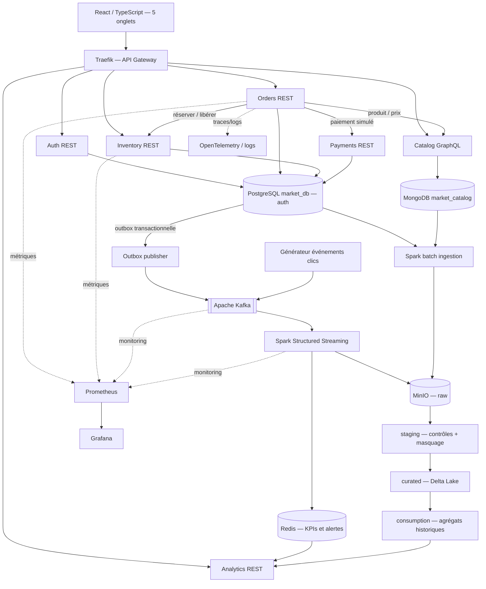
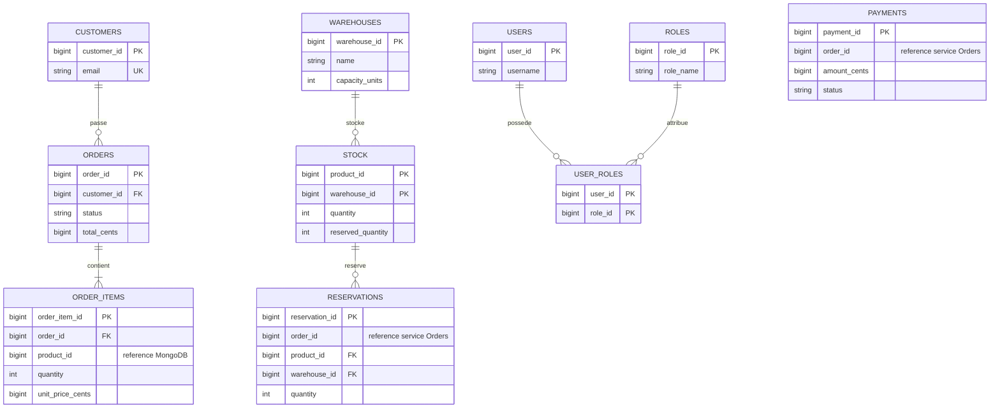
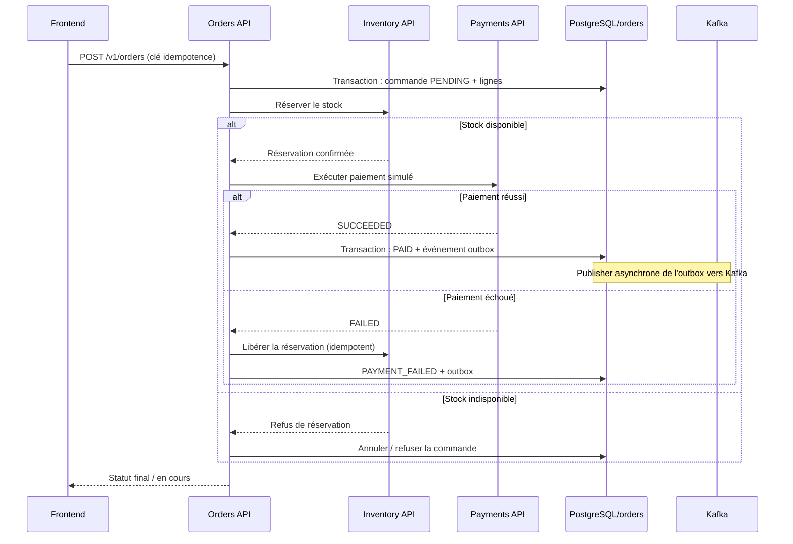

# Market Hardware — Architecture technique et composition du projet

**Statut :** spécification technique de référence (proposition V1)  
**Périmètre :** plateforme de pilotage d'un e-commerce de matériel informatique  
**Hors périmètre de ce document :** planning, répartition des tâches et responsabilités

## 1. Objectif et périmètre

Construire une plateforme de commerce et d'analyse de ventes de matériel informatique (CPU, GPU, RAM, SSD, cartes mères, alimentations, boîtiers, refroidissement et périphériques). Le prototype montre une chaîne **fonctionnelle de bout en bout** : commandes, paiements simulés, stock, catalogue, flux d'événements, historique analytique et supervision.

Les **quatre volets techniques** couverts sont : (1) stockage SQL / NoSQL, (2) Data Lake / Lakehouse, (3) plateforme de microservices et API, (4) streaming et traitement distribué.

L'application expose **cinq onglets** : Vue d'ensemble, Commandes, Catalogue, Logistique et Observabilité. Les valeurs affichées proviennent des services et pipelines réels, jamais de constantes de démonstration dans le frontend.

## 2. Stack retenue

| Couche | Choix technique | Usage |
|---|---|---|
| Frontend | React, TypeScript, Vite, Tailwind CSS, Recharts | Interface d'administration |
| Backend | Python 3.12, FastAPI, Pydantic, SQLAlchemy, Alembic | REST, services et migrations |
| GraphQL | Strawberry GraphQL (Python) | Catalogue produits |
| Base SQL | PostgreSQL, **une base `market_db` et quatre schémas** | Données transactionnelles |
| Base NoSQL | MongoDB, base `market_catalog` | Catalogue à attributs variables |
| Événements | Apache Kafka | Topics métier et simulateur de clics |
| Streaming | PySpark Structured Streaming | Agrégations, watermark, état, reprise |
| Lakehouse | MinIO + Parquet + Delta Lake | Stockage objet, historique et time travel |
| KPIs live | Redis | Cache matérialisé des mesures temps réel ; pas une source de vérité transactionnelle |
| Gateway | Traefik | Point d'entrée et routage ; contrôles d'accès sécurisés dans la chaîne gateway/services |
| Sécurité | JWT, RBAC, Argon2/bcrypt | Connexion et permissions |
| Observabilité | Prometheus, Grafana, OpenTelemetry, logs structurés | Santé des services et flux |
| Qualité | Pytest, Playwright, tests de contrats | Tests unitaires, intégration, E2E |
| Déploiement | Docker Compose, GitHub Actions | Infrastructure locale et CI |

**Alternatives non retenues dans cette proposition :** MySQL (PostgreSQL est le SGBDR choisi), Cassandra/Neo4j, Apache Iceberg (Delta Lake retenu), Spring Boot/NestJS. Ces alternatives ne sont pas obligatoires pour couvrir les quatre volets.

## 3. Architecture complète



**Note :** les flèches vers PostgreSQL représentent des connexions distinctes avec des rôles restreints : chaque service ne voit que son propre schéma. Le service de paiement est interne et n'est pas nécessairement exposé publiquement par la gateway.

## 4. Bases de données et schémas

### 4.1 PostgreSQL : un serveur, une base, quatre schémas

```text
PostgreSQL (un conteneur)
└── market_db
    ├── orders
    │   ├── customers
    │   ├── orders
    │   ├── order_items
    │   └── outbox_events
    ├── inventory
    │   ├── warehouses
    │   ├── stock
    │   └── reservations
    ├── payments
    │   └── payments
    └── auth
        ├── users
        ├── roles
        └── user_roles
```

#### Schéma `orders` — service Commandes

| Table | Colonnes principales | Contraintes / rôle |
|---|---|---|
| `customers` | `customer_id`, `first_name`, `last_name`, `email`, `created_at` | PK `customer_id`, email unique |
| `orders` | `order_id`, `customer_id`, `status`, `total_cents`, `created_at`, `updated_at` | PK, FK interne vers `customers`; total positif ou nul |
| `order_items` | `order_item_id`, `order_id`, `product_id`, `quantity`, `unit_price_cents` | FK interne vers `orders`; `product_id` = référence applicative MongoDB |
| `outbox_events` | `event_id`, `event_type`, `event_version`, `aggregate_id`, `payload`, `occurred_at`, `published_at` | Publication fiable des événements métier, sans transaction distribuée avec Kafka |

Statuts possibles de `orders.status` : `PENDING`, `STOCK_RESERVED`, `PAID`, `PAYMENT_FAILED`, `CANCELLED`, `SHIPPED`, `DELIVERED`.

#### Schéma `inventory` — service Stock

| Table | Colonnes principales | Contraintes / rôle |
|---|---|---|
| `warehouses` | `warehouse_id`, `name`, `city`, `capacity_units` | PK ; capacité strictement positive |
| `stock` | `product_id`, `warehouse_id`, `quantity`, `reserved_quantity`, `updated_at` | PK composée (`product_id`, `warehouse_id`), FK interne vers `warehouses`, `0 ≤ reserved_quantity ≤ quantity` |
| `reservations` | `reservation_id`, `order_id`, `product_id`, `warehouse_id`, `quantity`, `status`, `created_at` | FK interne (`product_id`, `warehouse_id`) vers `stock`; référence applicative à la commande |

Statuts de réservation : `ACTIVE`, `RELEASED`, `COMMITTED`. Quantité disponible = `quantity - reserved_quantity` tant qu'une réservation est active. Les opérations de réservation/libération doivent être atomiques et idempotentes.

#### Schéma `payments` — service Paiement

| Table | Colonnes principales | Contraintes / rôle |
|---|---|---|
| `payments` | `payment_id`, `order_id`, `amount_cents`, `status`, `method`, `idempotency_key`, `created_at` | PK ; clé d'idempotence unique ; référence applicative vers la commande |

Statuts : `PENDING`, `SUCCEEDED`, `FAILED`, `REFUNDED`. Les paiements sont **simulés** (pas de carte réelle).

#### Schéma `auth` — service Authentification

| Table | Colonnes principales | Contraintes / rôle |
|---|---|---|
| `users` | `user_id`, `username`, `password_hash`, `is_active`, `created_at` | PK ; identifiant unique ; hash, jamais mot de passe brut |
| `roles` | `role_id`, `role_name` | PK ; rôle unique |
| `user_roles` | `user_id`, `role_id` | PK composée ; deux FK internes |

Les comptes `auth.users` sont ceux de l'équipe utilisant la plateforme ; ils ne sont **pas** les clients `orders.customers`.

### 4.2 Diagramme relationnel (PostgreSQL)



**Important :** ce diagramme n'affiche des relations de type FK que **dans** chaque schéma propriétaire. `order_items.product_id`, `stock.product_id`, `reservations.order_id` et `payments.order_id` sont des références **applicatives** entre services, sans FK SQL inter-schémas.

### 4.3 MongoDB : base distincte `market_catalog`

Collection `products` :

```json
{
  "_id": "ObjectId généré par MongoDB",
  "product_id": 101,
  "sku": "GPU-001",
  "name": "Carte graphique exemple",
  "category": "GPU",
  "brand": "ExampleBrand",
  "price_cents": 45990,
  "active": true,
  "attributes": {
    "vram_gb": 12,
    "interface": "PCIe",
    "power_w": 200
  }
}
```

L'exemple illustre le format : les noms et valeurs sont fictifs. Les catégories possibles sont `CPU`, `GPU`, `RAM`, `SSD`, `MOTHERBOARD`, `PSU`, `CASE`, `COOLER`, `PERIPHERAL`. `attributes` varie selon le type de matériel. Index uniques sur `product_id` et `sku`, index de recherche sur catégorie/marque.

**Convention impérative :** `product_id` est attribué par le service Catalogue puis réutilisé **tel quel** dans PostgreSQL, Kafka, Delta Lake et les réponses API. Le champ `_id` natif de MongoDB n'est jamais utilisé comme identifiant métier transversal. Un contrôle applicatif garantit l'existence des produits référencés.

## 5. Relations fonctionnelles et cohérence des données

- Les prix sont en **centimes entiers** dans tous les systèmes (`price_cents`, `unit_price_cents`, `total_cents`, `amount_cents`). `unit_price_cents` représente un **instantané** du prix lors de la commande : une modification ultérieure du catalogue ne change pas l'historique.
- Les dates et heures échangées utilisent **UTC / ISO 8601** ; PostgreSQL stocke `TIMESTAMPTZ`.
- Le total d'une commande est la somme des lignes `quantity × unit_price_cents` ; des frais supplémentaires ne doivent être introduits que s'ils sont explicitement modélisés.
- Les identifiants de commandes, produits et entrepôts conservent le **même type logique** entre API, événements et bases.
- Le script de génération crée d'abord les produits MongoDB, puis les entrepôts et stocks, puis les clients, commandes et paiements cohérents.
- La réduction du stock et la publication des événements sont associées au **vrai parcours métier**, et non à deux jeux de données indépendants.
- Les données d'historique sont distinguées des événements temps réel simulés ; ne pas inventer des ventes « réelles » actuelles à partir de données fictives.

## 6. Microservices, API et ownership des données

| Service | Accès aux données | Interface principale | Responsabilité fonctionnelle |
|---|---|---|---|
| `orders-api` | schéma `orders` | REST `/v1/orders` | Créer, consulter et faire évoluer une commande ; orchestrer Saga |
| `inventory-api` | schéma `inventory` | REST `/v1/inventory`, `/v1/warehouses` | Disponibilités, réservations, libérations, entrepôts |
| `payments-api` | schéma `payments` | REST interne `/v1/payments` | Paiement simulé, idempotence, statut |
| `catalog-api` | MongoDB | GraphQL `/graphql` | Consulter, créer, modifier produits et attributs |
| `auth-api` | schéma `auth` | REST `/v1/auth` | Connexion, tokens JWT, rôles |
| `analytics-api` | Redis + tables analytiques | REST `/v1/dashboard`, `/v1/analytics` | KPIs, historique, alertes |

Les services utilisent des **comptes de base distincts** avec droits limités. Pas de jointure SQL ni de lecture directe de la base d'un autre service. Pour l'interface, les appels passent par la gateway ; les appels service-à-service utilisent un mécanisme d'authentification technique approprié.

### Parcours de commande avec compensation



Il faut traiter les erreurs temporaires, les retries et la reprise après panne : une commande ne doit pas être comptée deux fois après une réémission Kafka.

## 7. Contrats Kafka et traitement temps réel

Topics proposés : `market.orders.v1`, `market.payments.v1`, `market.inventory.v1`, `market.clicks.v1`. Utiliser `order_id` comme clé de partition pour les événements de commande ; `product_id` ou `warehouse_id` selon l'événement de stock.

Exemple de contrat commun :

```json
{
  "event_id": "9a780f4a-7273-476d-a3cd-b3ee0f04e7e3",
  "event_type": "order.confirmed",
  "event_version": 1,
  "occurred_at": "2026-10-23T08:00:00Z",
  "data": {
    "order_id": 5001,
    "customer_id": 15,
    "total_cents": 45990,
    "items": [{"product_id": 101, "quantity": 1, "unit_price_cents": 45990}]
  }
}
```

Exigences : validation JSON Schema, ID d'événement unique, gestion du retard (watermark), fenêtre(s) d'agrégation, état + checkpoint, journalisation des erreurs, test d'arrêt/reprise, déduplication à l'écriture. **Le checkpoint seul ne garantit pas exactement-once de bout en bout** : prévoir une stratégie d'idempotence / sortie transactionnelle et une vérification chiffrée des doublons.

Cas d'usage démontrés : chiffre d'affaires et nombre de commandes par fenêtre, produits bientôt en rupture, entrepôts avec remplissage supérieur à 90 %, alertes de paiement échoué et événements de clic/panier (selon le périmètre de simulation).

## 8. Data Lake / Lakehouse

```text
MinIO (stockage objet)
├── raw/           # données d'origine, immuables et horodatées
├── staging/       # nettoyage, typage, dédoublonnage, anonymisation
├── curated/       # tables Delta fiables et historisées
└── consumption/   # mesures et vues utiles aux dashboards et analyses
```

- **Batch :** export contrôlé de PostgreSQL et MongoDB vers `raw`, puis traitements Spark.
- **Streaming :** événements Kafka transformés et conservés avec leur traçabilité.
- **Qualité :** vérification des clés, valeurs nulles, montants, quantités, doublons ; rejets dans une zone de quarantaine documentée.
- **Protection des données :** masquage ou pseudonymisation des emails dès `staging`.
- **Gouvernance :** catalogue minimal (dataset, origine, schéma/version, fréquence, responsable fonctionnel du jeu de données, règles de qualité).
- **Démonstration :** lecture d'une ancienne version Delta (time travel), reprise du pipeline après interruption.

## 9. Frontend : composition des cinq onglets

| Onglet | Écrans et fonctions | Source des données |
|---|---|---|
| **Vue d'ensemble** | KPIs ventes/commandes/panier moyen, commandes par heure, faibles stocks, alertes | `analytics-api`, `inventory-api` |
| **Commandes** | Liste, filtres, détail, création, statuts, échecs de paiement | `orders-api` |
| **Catalogue** | Recherche, catégories, fiches, caractéristiques GPU/CPU/etc., ajout/édition | `catalog-api` (GraphQL) |
| **Logistique** | Entrepôts, capacité, stocks disponibles/réservés, seuil 90 %, alertes | `inventory-api`, `analytics-api` |
| **Observabilité** | Santé API/gateway/Kafka/Spark, latence, taux d'erreur, lag, traces | Prometheus/Grafana + observabilité |

Le frontend affiche explicitement chargement, absence de données et erreurs ; il respecte les autorisations. Pour le prototype, les KPIs peuvent être actualisés toutes les 5 secondes par polling (choix simplificateur, modifiable).

## 10. Sécurité et résilience

- JWT signé, expiration, utilisateurs et rôles applicatifs ; minimum trois rôles testables (par exemple admin, analyst, logistics) ; mot de passe haché.
- Exemples de tests : sans token → `401` ; token valide mais rôle interdit → `403` ; droit valide → succès. Les mutations GraphQL appliquent aussi les permissions.
- Secrets via variables d'environnement non commitées ; principe du moindre privilège pour les rôles PostgreSQL.
- Timeout, retry borné avec backoff, circuit breaker, bulkhead, idempotency keys ; démo d'une panne et d'une compensation Saga.
- Métriques Prometheus, Grafana, traces OpenTelemetry et logs structurés ; mesures de latence, erreurs et Kafka consumer lag.

## 11. Données de démonstration

Jeu de départ **synthétique, déterministe, modeste**, extensible pour les tests de charge : environ 30 produits, 20 clients, 50 commandes, 3 entrepôts, paiements associés, 5 utilisateurs d'administration et flux simulé de quelques centaines d'événements. Ces tailles sont des **propositions de développement**, pas des minimums imposés par l'énoncé.

Le générateur doit respecter les référentiels et produire des scénarios : commande payée, paiement échoué et stock libéré, stock faible, entrepôt > 90 %, événement dupliqué, événement en retard et reprise du streaming. Déterminisme via une graine (`seed`) et IDs stables.

## 12. Composition du dépôt / arborescence cible

```text
market-hardware/
├── README.md
├── AGENTS.md
├── .env.example
├── docker-compose.yml
├── contracts/
│   ├── openapi/                 # commandes, stock, paiement, auth, analytics
│   ├── graphql/                 # catalogue
│   └── events/                  # market.orders.v1.json, etc.
├── database/
│   ├── postgres/
│   │   ├── 01_postgres_schemas.sql
│   │   ├── 02_postgres_tables.sql
│   │   └── migrations/
│   ├── mongodb/
│   │   └── 03_mongodb_catalog.js
│   └── seed/                    # générateur et validations des relations
├── services/
│   ├── orders-api/
│   ├── inventory-api/
│   ├── payments-api/
│   ├── catalog-api/
│   ├── auth-api/
│   └── analytics-api/
├── eventing/
│   ├── outbox-publisher/
│   └── click-generator/
├── pipelines/
│   ├── batch/
│   ├── streaming/
│   ├── quality/
│   └── lakehouse/
├── frontend/
│   ├── src/features/overview/
│   ├── src/features/orders/
│   ├── src/features/catalog/
│   ├── src/features/logistics/
│   └── src/features/observability/
├── infrastructure/
│   ├── traefik/
│   ├── prometheus/
│   ├── grafana/
│   └── otel/
├── tests/
│   ├── unit/
│   ├── contract/
│   ├── integration/
│   ├── e2e/
│   └── recovery/
└── docs/
    ├── architecture/
    ├── ADR/
    ├── data-dictionary.md
    ├── api-reference.md
    └── demo-validation.md
```

## 13. Critères d'acceptation globaux

- Une commande valide est créée **atomiquement** ; un paiement échoué entraîne la libération du stock réservé ; la répétition d'une requête ne double pas la réservation.
- Un `product_id` donné identifie le **même produit** en MongoDB, PostgreSQL, événements Kafka, Lakehouse et API ; pas de clés étrangères entre services.
- Les cinq onglets sont accessibles et alimentés par les véritables services/données ; aucune statistique métier de démonstration n'est codée en dur dans l'UI.
- Le pipeline Kafka → Spark montre fenêtres, watermark, checkpoint, alertes et comportement après arrêt/redémarrage.
- Le Lakehouse contient les quatre zones, une table Delta versionnée, des contrôles qualité et un catalogue minimal ; démonstration de time travel.
- REST et GraphQL documentés contract-first ; APIs versionnées, gateway et authentification fonctionnelles.
- Résilience (timeouts, retry, circuit breaker) démontrée ; Prometheus/Grafana/OpenTelemetry exploitables.
- Tests automatisés unitaires, contrat, API, intégration et E2E ; environnement reproductible avec Docker Compose et documentation claire.
- Le dépôt inclut schémas, scripts, architecture, ADRs (au moins un par volet), rapport technique et scénario de démonstration. Aucun secret dans Git.

## 14. Références et distinction entre requis et choix proposés

Ce document se base sur l'énoncé **« Projet final — un Acteur du Retail e-commerce »** fourni dans la conversation, et sur la modélisation de référence des quatre schémas PostgreSQL et du catalogue MongoDB. Les choix concrets **FastAPI, Strawberry, Traefik, Redis, Delta Lake, noms des topics, conventions de fichiers, tailles de données, structures de répertoire** sont des **propositions d'implémentation**, pas des obligations de l'énoncé. Les scripts SQL/MongoDB précédemment préparés constituent le point de départ du schéma physique ; ils devront être migrés et vérifiés avant insertion des données.
