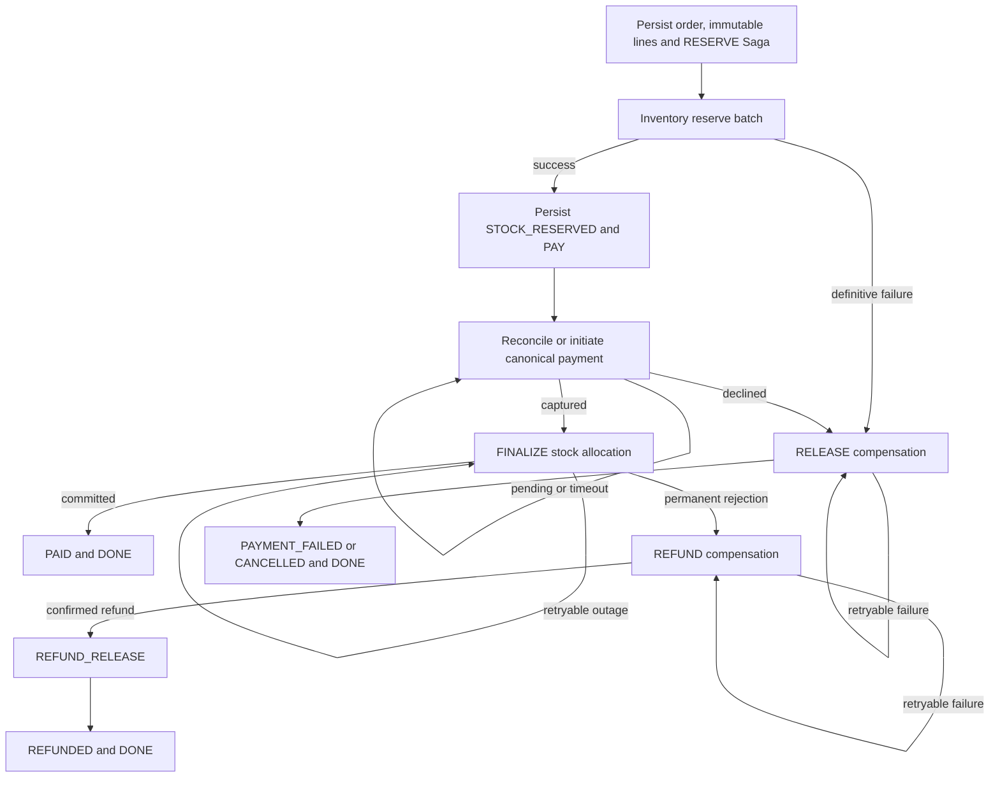

# Phase 4: transactional e-commerce backend

The local backend reuses Phase 2 PostgreSQL rules and Phase 3's published catalogue. The V3 requirements and source fixture files remain unchanged. Implementation and verification results are recorded at the end of this document.

## Architecture and ownership

| Service | Responsibility | Restricted PostgreSQL login |
| --- | --- | --- |
| services/auth | Registration, Argon2id login, JWT issuance, session rotation/revocation, RBAC | market_auth_api; auth only |
| services/inventory | Availability, atomic reservations, commit/release/expiry, authorized adjustments | market_inventory_api; inventory only |
| services/orders | Published cart validation, immutable purchase snapshots, ownership and Saga orchestration | market_orders_api; orders only |
| services/payments | Deterministic simulated provider, attempts, refunds and financial audit | market_payments_api; payments only |
| checkout-saga | Durable Orders orchestration and HTTP-triggered Inventory/Payments maintenance | Orders login only |
| workers/outbox-publisher | Claim and acknowledge schema-owned outboxes | market_outbox_worker; outbox delivery columns only |

The service entry points use shared market_commerce modules to avoid duplicating authentication, errors, request handling and SQL transaction conventions. Only the appropriate schema credential is passed into each service container. No application receives the PostgreSQL owner password or superuser privileges. The publisher cannot modify business tables or event payloads. Business services cannot mark outbox events published. Monitoring audit writes remain trigger-controlled.

Cross-service references are logical IDs. No cross-schema foreign keys, joins or direct business reads were added. HTTP calls take place outside PostgreSQL transactions. Four business schemas remain auth/orders/inventory/payments; monitoring is technical. Catalog GraphQL, MongoDB, Neo4j, UnoPim and product-sync remain the existing Phase 3 implementation.

## Start, verify and test on Windows

From C:\market-hardware with existing infrastructure/data initialized:

```powershell
powershell -NoProfile -ExecutionPolicy Bypass -File .\scripts\start-commerce.ps1
powershell -NoProfile -ExecutionPolicy Bypass -File .\scripts\verify-commerce.ps1
powershell -NoProfile -ExecutionPolicy Bypass -File .\scripts\test-commerce.ps1
# Enable real Kafka publication:
powershell -NoProfile -ExecutionPolicy Bypass -File .\scripts\start-commerce.ps1 -WithKafka
docker compose --profile catalog --profile commerce --profile streaming ps
```

start-commerce installs the pinned service dependencies, applies checksum-verified migrations, provisions missing runtime secrets and separate development accounts directly in the ignored .env, builds only the commerce image and waits for service health. It explicitly reloads Traefik because Windows file-mount notifications are unreliable. It never resets databases or builds/replaces Phase 3 services.

Kafka retains its original kafka profile; streaming is an alias. Without -WithKafka, KAFKA_ENABLED=0 is written directly to .env and the publisher leaves all events queued. A broker already running is not destroyed. With -WithKafka, Kafka starts with its persistent volume and the publisher waits for real acknowledgements. No Spark consumer is started.

verify-commerce runs an actual authenticated checkout through Traefik using isolated warehouse stock. It checks readiness/routes/OpenAPI, real payment persistence, stock commitment, confirmed order state, outbox records, 42 active catalogue products, the inactive Phase 3 product and compatibility relationships. It compares catalogue/graph fingerprints before and after the checkout.

test-commerce pauses workers during Phase 2/3 seed-regression tests, restores the Saga worker, starts Kafka, and runs Phase 4 integration/concurrency/crash tests. It intentionally stops/restores Kafka and crashes the actual Saga process. Background workers are restored in finally. Reports are saved under ignored .local/commerce-regressions.xml and .local/commerce-phase4.xml. Test accounts/warehouses/orders/payments are retained separately for audit; repeated verification never deletes historical rows.

## Authentication setup

Development identities/passwords are stored in .env as DEV_ADMIN_EMAIL/PASSWORD, DEV_CUSTOMER_EMAIL/PASSWORD and DEV_OTHER_EMAIL/PASSWORD. Their database hashes use Argon2id. Bootstrap is repeatable, never rotates existing passwords, never activates the 22 disabled Phase 2 fixtures, and refuses collisions with disabled accounts. Do not copy passwords/tokens into commands, reports or Git.

Register accepts username, email, password (12..128 characters), first_name and last_name. Public registration always assigns customer. Existing operator is mapped to API staff; admin remains admin. No public role-escalation endpoint exists.

Access tokens are HS256 JWTs with required expiration, issued-at, subject, session ID, type, issuer market-hardware and audience market-commerce. The random signing key is in .env; internal service tokens use a separate key, short expiry, service subject and target audience. Every authenticated commerce request verifies JWT claims and asks Auth to check the current user/session/roles. Disabling a user or revoking a session therefore blocks existing access tokens too.

Refresh tokens are high-entropy opaque secrets; PostgreSQL stores only SHA256 hashes. Rotation revokes the old session and creates a successor. Reuse of a revoked refresh token revokes the entire successor family and commits that revocation before returning a generic 401. Logout revokes the family. Password failures and unknown/disabled users share generic errors and a dummy Argon2 verification path.

Authentication endpoints use a persisted per-source-IP, per-action minute limiter (default 60). Request validation omits submitted input values from errors. Logs never include authentication bodies or tokens. The local gateway is loopback HTTP as in Phase 3; internet deployment, certificate management, MFA, account recovery and a full abuse-protection gateway are not implemented in this local phase.

## REST endpoints

All public routes use http://localhost:8080. Each service publishes Swagger at /api/<service>/docs and its exported OpenAPI document at /api/<service>/openapi.json. Swagger includes bearer authentication; internal routes are omitted. Generic error envelope: error.code, error.message, optional error.details and correlation_id. Responses propagate X-Correlation-ID. Only the two localhost:5173 React development origins are allowed by CORS.

| Method/path | Access and behavior |
| --- | --- |
| POST /api/auth/register | Public registration; customer role only |
| POST /api/auth/login | Generic credential verification; access/refresh pair |
| POST /api/auth/refresh | Rotate refresh token; reuse detection |
| POST /api/auth/logout | Revoke refresh family |
| GET /api/auth/me | Active authenticated session/profile/roles |
| GET /api/inventory/products/{product_id} | Authenticated physical/reserved/available totals |
| GET /api/inventory/availability/{product_id} | V3 alias for availability |
| GET /api/inventory/products/{product_id}/warehouses | Authenticated per-warehouse stock |
| POST /api/inventory/warehouses | Staff/admin; create isolated warehouse; name is idempotent identity |
| POST /api/inventory/adjustments | Staff/admin; UUID Idempotency-Key, signed quantity delta and reason |
| POST /api/inventory/reservations | Staff/admin only; must exactly match an actual checkout's lines |
| GET /api/inventory/reservations/{id} | Checkout owner or staff/admin |
| POST /api/inventory/reservations/{id}/confirm | Staff/admin; only already-paid checkout context |
| POST /api/inventory/reservations/{id}/release | Staff/admin; only terminal failed/cancelled/refunded context |
| POST /api/inventory/expire | Staff/admin; safe expiry reconciliation |
| POST /api/orders/cart/validate | Authenticated published products/prices plus real warehouse availability; no reservation |
| POST /api/orders | Authenticated checkout; required Idempotency-Key |
| GET /api/orders | Own paginated orders; all_customers=true requires staff/admin |
| GET /api/orders/{id} | Owner or staff/admin; frozen lines and durable progress |
| GET /api/orders/{id}/status | Authorized state and completion/progress |
| POST /api/orders/{id}/cancel | Authorized cancellation before finalization; refund if capture is discovered |
| POST /api/payments | Owner-authorized idempotent payment/retry through the existing checkout; cannot bypass reservations |
| GET /api/payments/{id} | Owner or staff/admin; persisted simulated result |
| POST /api/payments/{id}/refund | Staff/admin; required Idempotency-Key; bounded refundable amount |
| GET /api/<service>/health | Readiness; DB plus appropriate upstream dependencies |
| POST /graphql | Existing Phase 3 published catalogue and compatibility reads |

Internal /internal/* endpoints have no gateway routes, no host-published service ports and require audience-bound service authentication. Reservation/charge commands are Orders-only. Inventory and Payments can request authorized order context; Auth validates active sessions for the three business callers. Customer-facing reservation reads check ownership through Orders HTTP, never cross-schema SQL.

## Checkout and immutable money

POST /api/orders body:

```json
{"items":[{"product_id":1001,"quantity":1}],"warehouse_id":1}
```

The service reads active approved products from the actual GraphQL endpoint. It freezes product_id, SKU, product name, quantity, currency, integer-cent unit price, catalogue publication version and warehouse choice in SQL lines. Decimal arithmetic calculates totals exactly; mixed currencies, duplicate products, invalid quantities, unpublished/inactive IDs and oversized totals are rejected. A supplied unit_price_cents hint is accepted but never trusted. The published server price always wins.

Idempotency is enforced by PostgreSQL keys on (auth user, checkout key), a canonical request hash and a transaction-scoped lock. Identical retries return the same order even if catalogue prices later change; changed payloads with the same key return 409. SQL triggers preserve confirmed purchase values. Historical fixtures keep their original values; new snapshot columns are nullable/defaulted for those rows.

Orders retain the existing PENDING -> STOCK_RESERVED -> PAID states. PAID means payment captured and inventory committed. Cancellation is allowed before the FINALIZE boundary. A cancellation while payment is uncertain remains pending until it is safely reconciled; discovered captures are refunded. Already-finalized orders require a staff/admin refund, rather than pretending an unpaid cancellation occurred. SHIPPED and DELIVERED remain existing legal future fulfilment states; shipping APIs are outside this phase.

Payments retain PENDING -> SUCCEEDED/FAILED and SUCCEEDED -> REFUNDED. Refunds have PENDING -> SUCCEEDED/FAILED, with FAILED -> PENDING only for an identical retry. PostgreSQL locks the captured payment and sums pending/successful refunds before accepting a refund; refunds cannot exceed capture. Unique payment/order and refund/payment/key constraints prevent duplicate captures/refunds. Refund failures and successful amounts are persisted and financially audited. Full refunds reconcile the Order to REFUNDED; a durable notification flag retries when Orders is unavailable. Refunds of already allocated goods do not automatically restock them; returns/fulfilment and an authorized physical stock adjustment are separate operations.

## Saga state and recovery



Each step claims a persisted twenty-second lease in a short Orders transaction, performs HTTP outside the transaction and conditionally advances only the same owner/step. Remote reservations, captures, confirmations, releases and refunds have independent durable business identities. Retries have persisted failure codes/history and exponential delay capped at 60 seconds. One loop makes bounded attempts; later loops continue until reconciliation succeeds. A process crash leaves STARTED history and a lease that expires; the restarted worker safely repeats the same command.

Inventory batch reservation/confirmation is one local transaction. Warehouse/stock locks, existing reservation triggers, deferred reserved-sum checks and unique business keys prevent overselling. Confirmation decrements physical and reserved quantities once. Repeated release does not decrement again. New reservations expire after 15 minutes by default; legacy fixture reservations have no newly invented expiry.

Expiry first asks Orders for a durable safe-release decision. RESERVE can atomically become RELEASE, fencing concurrent advancement to PAY. PAY/FINALIZE are protected while financial outcome may be unknown. An unreachable provider can therefore retain a protected reservation until reconciliation; operators must restore the service rather than release potentially sold goods blindly.

If a payment response times out after capture, the Saga queries the canonical order payment before attempting another charge. It never announces definitive failure while payment is uncertain. A crash after stock commits but before Orders records PAID repeats the idempotent confirmation and completes without decrementing stock twice. A permanent downstream rejection enters REFUND and only terminates after the financial result and reservation release are known.

## Local simulation and fault controls

Ordinary checkout/payment bodies forbid simulation controls. In this local development setup COMMERCE_TESTING=1 enables staff/admin-only POST /api/orders/testing/plans, keyed by user and checkout Idempotency-Key. Plans select success, decline, timeout_once, timeout_succeeded or refund_fail_once. Provider attempts remain durable; timeout_once settles on retry and timeout_succeeded captures before returning a timeout. Refund failure is deterministic on the first attempt for that refund identity.

Plans can pause after reservation, inject a single finalization/compensation failure, or crash the actual Saga worker after reserve, capture or stock finalization. Crash flags are durably consumed before exit, preventing a restart loop. POST /api/orders/{id}/testing/resume clears a pause. Set COMMERCE_TESTING=0 in .env and recreate commerce services to disable test plans. This is a documented local test facility, not customer-controlled payment behavior.

## Transactional outbox and Kafka

Database triggers write lifecycle events in the same transaction as Orders, Payments and Inventory changes. Auth registration and stock adjustments explicitly insert their events before their local commit. No trigger calls Kafka, SMTP or HTTP. New events have stable event IDs, event version, aggregate type/ID, timestamp, correlation/causation metadata, idempotency information and structured payloads. Historical source event bodies are preserved.

The fixed topic contract is market.auth.v1, market.orders.v1, market.inventory.v1 and market.payments.v1. Order events include order.created, order.stock_reserved, order.confirmed, order.failed, order.cancelled and order.refunded. Existing inventory names inventory.reserved, inventory.reservation_released and inventory.committed are retained. Payment events include payment.pending, payment.succeeded, payment.failed, payment.refunded and refund outcomes. Envelope schema: data/contracts/events/market.commerce.v1.schema.json. This freezes V3's formerly illustrative topic names without editing the specification.

The publisher uses FOR UPDATE SKIP LOCKED, commits a fifteen-second claim and increments attempts before sending. It uses an idempotent Kafka producer and acks=all, requires a successful delivery callback, then persists publication time and broker partition/offset. On unavailable Kafka it keeps published_at NULL, records the error and backs off up to 60 seconds. No broker acknowledgement means no published marker. Claim expiry recovers dead publishers.

A crash after Kafka acknowledges but before PostgreSQL acknowledgement can deliver the same event_id twice. This is at-least-once delivery, not exactly-once end-to-end. Tests observe two real Kafka records after such a crash and apply both to a persisted inbox that records one logical effect. Future business consumers must transact their own inbox and side effect together. The example inbox is a verification mechanism; invoice/notification/Spark consumers and consumer dead-letter processing are later phases.

## Failures, operational rollback and limitations

For a pending checkout, GET its status and inspect orders.sagas and orders.saga_attempts through authorized operational tooling. Restore unavailable services and restart checkout-saga; do not manually replay charges with another identity. Compensation failures remain durably retryable. Refund notification failures stay marked notify_pending. An outbox failure retains last_error and an unpublished record; restore Kafka and restart the publisher. Never set published_at manually or delete a failed event.

All SQL migration versions 006..010 are additive and transactional; previously applied migrations are checksum-verified. Old Phase 2/3 code remains compatible with the extra structures. Operational rollback means stop accepting commerce requests, allow pending Sagas to settle, then stop the four commerce APIs and two commerce workers while keeping Phase 3 running. The executable `scripts/rollback-commerce.ps1` refuses incomplete Sagas, fences new requests and stops only commerce services. Re-enable with start-commerce to resume retained progress. Physical downgrade of populated financial/session/Saga tables is intentionally not automated: dropping those records would conflict with the non-destructive requirement. Existing data is retained across application rollback.

The local gateway still uses HTTP; TLS/production rollout is not claimed. Payments are simulated; no banking integration exists. Refunds are role-restricted but a full returns/fulfilment workflow is not implemented. Technical log retention, invoice PDFs/emails, React, Spark and AI PC Builder remain later phases. Live verification uses REST/GraphQL and actual containers, not browser click-through tests.

## Files and migrations

Created shared service code under market_commerce/, service entry points/readmes under services/{auth,orders,inventory,payments}/, workers/outbox-publisher/, the pinned commerce Dockerfile/dependencies, public OpenAPI exports and the commerce event envelope contract. Added scripts/configure-commerce.py, start-commerce.ps1, verify-commerce.ps1, test-commerce.ps1 and rollback-commerce.ps1. Added tests/integration/test_phase4.py and ADR 0003. Modified root Compose, Traefik routes, development dependencies, README/AGENTS and Phase 2/3 regressions. The existing GraphQL implementation received only the narrow concurrency execution fix documented in the ADR.

| Migration | Added behavior |
| --- | --- |
| 006_commerce_state.sql | Refresh sessions, checkout idempotency, Saga state, expiry, refund/audit tables and delivery metadata |
| 007_commerce_guards_and_events.sql | Extended immutable snapshots, refund bounds/state guards, versioned lifecycle event names |
| 008_event_record_dispatch.sql | Generic trigger record dispatch through JSON, preserving each table's primary key |
| 009_commerce_snapshot_permissions.sql | Complete new checkout-line snapshots; only publisher may acknowledge events |
| 010_saga_attempt_history.sql | Persisted step/lease/attempt outcomes, including crashed attempts |

## Verification results

Verified locally on 2026-10-23 using the actual Docker services:

- 231 Phase 2/3/unit regression checks passed, 0 failed/errors/skipped (includes the new 160-query concurrent selection check).
- 45 Phase 4 integration/concurrency/recovery checks passed, 0 failed/errors/skipped.
- Total: 276 distinct automated tests passed. Both standalone verify-commerce runs also passed their two live smoke checks, before and after operational rollback/restore.
- start-commerce.ps1 -WithKafka, test-commerce.ps1, verify-commerce.ps1 and rollback-commerce.ps1 were executed successfully on Windows PowerShell. Phase 3 remained reachable with 42 active products while commerce was stopped, then commerce was restored and verified.
- Auth, Inventory, Orders, Payments, checkout-saga, outbox-publisher, Kafka, Traefik, the catalogue and required data/PIM services are running healthy.
- Final audit: zero incomplete Sagas, zero unresolved product-sync jobs, 42 active catalogue products, one inactive retained product and 163 validated relationships. All 22 disabled password fixtures remain inactive.
- Kafka-acknowledged outboxes contained 12 Auth, 257 Orders, 138 Inventory and 201 Payments events, with zero pending events at the final audit. These include preserved historical events plus retained verification activity; counts grow with later use.
- V3 requirements and all tracked source CSV/JSON fixtures remain unchanged. The concurrency regression initially exposed missing GraphQL fields and a recovery test racing its retry deadline; the narrow fixes are documented in ADR 0003 and the final full run passed.

JUnit reports are local under .local/commerce-regressions.xml and .local/commerce-phase4.xml. Ruff, dependency compatibility, Compose configuration and PowerShell parsing checks passed. No local secret values were found in changed/new tracked candidates.

References checked: [PyJWT claim validation](https://pyjwt.readthedocs.io/en/stable/usage.html), [Argon2id password handling](https://argon2-cffi.readthedocs.io/en/stable/howto.html), [Confluent Python producer callbacks](https://docs.confluent.io/kafka-clients/python/current/overview.html), [Kafka delivery semantics](https://docs.confluent.io/kafka/design/delivery-semantics.html).

## Change manifest

- AGENTS.md
- README.md
- data/contracts/README.md
- data/contracts/events/market.commerce.v1.schema.json
- data/contracts/openapi/auth.v1.json
- data/contracts/openapi/inventory.v1.json
- data/contracts/openapi/orders.v1.json
- data/contracts/openapi/payments.v1.json
- data/postgres/schema/migrations/006_commerce_state.sql
- data/postgres/schema/migrations/007_commerce_guards_and_events.sql
- data/postgres/schema/migrations/008_event_record_dispatch.sql
- data/postgres/schema/migrations/009_commerce_snapshot_permissions.sql
- data/postgres/schema/migrations/010_saga_attempt_history.sql
- docker-compose.yml
- docs/ADR/0003-commerce-saga-outbox.md
- docs/phase4-commerce.md
- infrastructure/compose/commerce.Dockerfile
- infrastructure/traefik/catalog.yml
- market_catalog/api.py
- market_commerce/__init__.py
- market_commerce/auth.py
- market_commerce/common.py
- market_commerce/inventory.py
- market_commerce/orders.py
- market_commerce/outbox.py
- market_commerce/payments.py
- market_commerce/saga.py
- requirements-dev.txt
- scripts/configure-commerce.py
- scripts/rollback-commerce.ps1
- scripts/start-commerce.ps1
- scripts/test-commerce.ps1
- scripts/verify-commerce.ps1
- services/auth/README.md
- services/auth/main.py
- services/commerce-requirements.lock
- services/commerce-requirements.txt
- services/inventory/README.md
- services/inventory/main.py
- services/orders/README.md
- services/orders/main.py
- services/payments/README.md
- services/payments/main.py
- tests/integration/test_phase2.py
- tests/integration/test_phase3.py
- tests/integration/test_phase4.py
- workers/outbox-publisher/README.md
- workers/outbox-publisher/main.py
