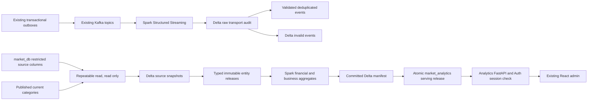

# Phase 6: local lakehouse analytics

Phase 6 adds an optional Spark worker and a read-only FastAPI service to the existing Docker project. It consumes the existing four commerce Kafka topics, retains transport evidence in Delta on MinIO, reconciles historical and current source snapshots, materializes Spark Gold tables and publishes complete serving versions. The React administration page is `/admin/analytics`. No AI, invoicing, notifications or Spark cluster fleet is included.



## Run on Windows

First start the existing Phase 2–5 infrastructure, catalogue, commerce with `start-commerce.ps1 -WithKafka`, and frontend. General infrastructure startup must also retain `-WithKafka` while analytics is active; the earlier default startup deliberately stops an optional broker. From `C:\market-hardware`:

```powershell
powershell -NoProfile -ExecutionPolicy Bypass -File .\scripts\start-analytics.ps1
powershell -NoProfile -ExecutionPolicy Bypass -File .\scripts\backfill-analytics.ps1
powershell -NoProfile -ExecutionPolicy Bypass -File .\scripts\run-quarterly-analytics.ps1 -Year 2025 -Quarter 1
powershell -NoProfile -ExecutionPolicy Bypass -File .\scripts\verify-analytics.ps1
powershell -NoProfile -ExecutionPolicy Bypass -File .\scripts\test-analytics.ps1 -WithRecovery
docker compose --profile analytics ps
docker compose --profile analytics logs --tail 60 analytics-worker
powershell -NoProfile -ExecutionPolicy Bypass -File .\scripts\stop-analytics.ps1
```

The recovery tests temporarily stop Kafka and MinIO and restart the actual Spark driver. Run them serially with commerce regression and browser tests. They restore dependencies in `finally`. Do not restart Traefik during an acceptance run. Stopping analytics retains all Delta files, checkpoints, SQL releases, Kafka records and Docker volumes. No `down -v`, topic deletion, offset reset or destructive SQL is used.

Provisioning adds missing secrets directly to ignored `.env`, without rotating existing credentials. It adds three restricted PostgreSQL roles, a separate `market_analytics` database, checksum-verified technical SQL migrations and the private `market-lakehouse` bucket. Business migrations 001–010 and V3 requirements remain unchanged.

## Runtime and durability

The image pins Spark 3.5.7, Delta 3.3.2, Python 3.12.13 and Java 17. Maven jars and their SHA512 checksums are locked, including Hadoop AWS 3.3.4 matching the actual Spark Hadoop jars. Images are digest-pinned. Dependencies use a complete pip constraint lock. The driver uses `local[2]`, a 1 GiB Java heap and a 2500 MiB container limit; the API uses 384 MiB. Docker has about 7.6 GiB on this Windows host; keep a single worker. Initial materialization can take minutes; unchanged source verification is much cheaper. A 15-second streaming trigger is a scheduling target, not a freshness SLA.

Spark writes via S3A using path-style access and `S3SingleDriverLogStore`. A session advisory lock plus a Python reentrant lock serialize every writer, including asynchronous `foreachBatch` callbacks, periodic snapshots and queued quarterly/backfill jobs. This is a single-driver local deployment. It is not safe to scale writers horizontally or write these tables from another tool. Delta transaction logs and Structured Streaming checkpoints are in the existing persistent MinIO volume. No vacuum or checkpoint cleanup is scheduled.

Snapshots use one PostgreSQL `REPEATABLE READ READ ONLY` transaction and explicit column lists. Each table is exported independently; only Spark joins across analytical entities. Customer identifiers are HMAC pseudonyms, with the persistent key in `.env`; no names, emails, password hashes, sessions or tokens are exported. Catalogue category reads occur after the SQL snapshot and are explicitly current classification. A SHA256 digest of source content plus the transformation version identifies each immutable release; re-importing identical content does not duplicate entities, Gold or reports. SQL snapshot boundaries and observation times remain recorded.

Events are notifications, not complete CDC: old payloads lack lines and refund balances. Bronze records event evidence; authoritative snapshots determine financial state. New microbatches and a periodic reconciliation detect updates, including partial refunds. Out-of-order events cannot roll a payment back. All late records are retained without a financial watermark discard. See [KPI definitions](phase6-kpi-definitions.md) for the deliberate cohort semantics.

## Serving and security

The worker reads committed Delta Gold and manifests before publishing an immutable JSONB release and its pointer in one SQL transaction. Readers see one complete release. The API has only its serving database SELECT role and Auth validation key; it has no source database or MinIO credentials. It performs no Spark work and no transactional business reads per request. Filtering and bounded pagination operate over already materialized local Gold records. This lightweight projection is intended for the current small local dataset, not millions of rows.

Every business analytics endpoint verifies the JWT and checks the current session/role using Auth `/api/auth/me`. Admin and staff/operator can read; customers receive 403 and unauthenticated clients 401. Analytics is absent from checkout's dependency graph. The worker currently reuses the existing local MinIO administrative credentials; keep them private in `.env`. Bucket-scoped IAM and TLS are deployment hardening extensions, not claimed here. All services remain on the existing Docker network behind loopback Traefik.

| Read-only endpoint | Materialized result |
| --- | --- |
| `/api/analytics/overview` | Financial, order and customer KPIs |
| `/api/analytics/revenue` | Day, month or quarter revenue |
| `/api/analytics/orders` | Daily orders and statuses |
| `/api/analytics/products/top` | Paginated products and category totals |
| `/api/analytics/inventory` | Warehouse stock, low-stock threshold and pagination |
| `/api/analytics/customers` | Registration and purchasing cohorts |
| `/api/analytics/quarters` | Latest stored report per quarter |
| `/api/analytics/quarters/{year}/{quarter}` | Existing quarter; 404 until queued batch completes |
| `/api/analytics/pipeline/status` | Durable progress, lag and reconciliation |
| `/api/analytics/health` | Serving readiness, degraded when stale |

Date filters use `from` inclusive and `to` exclusive, UTC. Revenue granularity is `day`, `month` or `quarter`. Page size is 1–100. OpenAPI and Swagger are `/api/analytics/openapi.json` and `/api/analytics/docs`. The consistent envelope is `data`, `metadata`, `definitions`; metadata identifies release, snapshot, latest successful verification, staleness and financial basis. The dashboard rejects mixed release responses and supports manual refresh or non-overlapping 30-second polling. A dependency failure retains the last complete version with a stale warning.

The dashboard has exact-cent money formatting, filters, accessible revenue lines plus a numeric fallback table, product/category results, current warehouse stock, quarterly reports, reconciliation and pipeline evidence. It labels synthetic history, snapshot freshness, customer scope and cohort corrections. Existing Phase 5's assertion that Analytics was unimplemented is deliberately replaced by an assertion for the actual analytics page; deferred AI and observability assertions remain.

See [dictionary](phase6-data-dictionary.md), [reconciliation](phase6-reconciliation.md), [recovery](phase6-recovery.md), [audit](phase6-architecture-audit.md), [ADR 0005](ADR/0005-lakehouse-analytics.md), and the final [execution report](phase6-execution.md).
