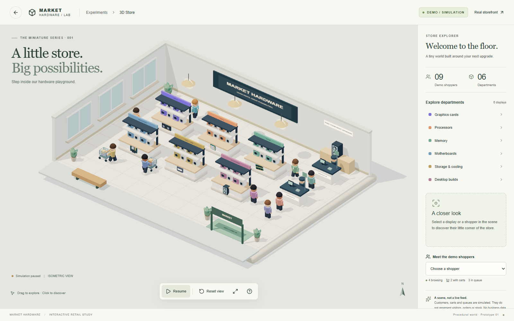

# Miniature electronics store — prototype 01

Branch: **`3d-test-branch`**. Route: **`/admin/3d-store`**. This experiment preserves the existing storefront/admin routes and uses the existing staff/admin authentication guard. A new **3D Store · Demo** link appears below the main admin navigation.

## Launch locally

With the existing local backend/gateway running and its original `.env` retained:

```powershell
cd C:\market-hardware
git switch 3d-test-branch
cd frontend
npm ci
npm run dev
```

Open **http://127.0.0.1:5173/admin/3d-store** and sign in with the existing `DEV_ADMIN_EMAIL` / `DEV_ADMIN_PASSWORD` from the ignored root `.env`. No additional environment variables or databases are required. Keep port 5173 available; it matches the existing development setup. The Vite proxy forwards existing API requests to `127.0.0.1:8080`.

If the entire platform is stopped, use the existing retained-state startup instructions in the [root README](../README.md#start-an-existing-installation). For visual-only development, this audit started only the existing PostgreSQL, MongoDB, Neo4j, Auth, catalogue and Traefik containers with `docker compose start postgres mongo neo4j auth catalog-graphql traefik`; this does not start the complete commerce platform. Do not seed/reset databases to view this prototype.

For the existing Docker frontend deployment, build/recreate only that service:

```powershell
cd C:\market-hardware
docker compose --profile frontend build frontend
docker compose --profile frontend up -d --no-deps --wait frontend
```

With its existing gateway/auth dependencies running, visit **http://localhost:8080/admin/3d-store**. The prototype was browser-tested through Vite; a new Docker frontend deployment was not performed during this change.

## Explore

- Left-drag to orbit, right-drag to pan, scroll/pinch to zoom.
- Click a display to inspect its department; click a shopper to inspect their simulated activity.
- Use the department buttons and shopper selector for keyboard-accessible selection.
- Pause/resume animation, reset the camera, expand the scene or open camera help in the bottom toolbar.
- Reduced-motion preference starts paused; changing to reduced motion pauses the simulation. You can explicitly resume it.

Six custom departments include GPU/CPU/RAM/motherboard displays, storage/cooling and PC builds. The cutaway shop includes windows, pendant lights, hardware models, checkout counters, staff, plants, an entrance and outdoor bench. Nine simulated shoppers include four browsers, two cart users and three fixed queue members. Two decorative cashiers are separate from the shopper count.

**All shoppers, carts, browsing and queues are simulated.** No activity represents actual visitors or orders. The scene imports no business API client, sends no inventory/order/payment requests and writes no customer/product/business data. Authentication remains the existing application behavior. Product displays are decorative, not live prices or stock.

## Implementation and limits

- React Three Fiber 9 / Three.js / Drei; orthographic isometric starting camera and OrbitControls.
- All geometry and lettering are procedural, authored in this repository. No third-party models, external font files, texture downloads, asset CDN or unverified asset license is involved. Canvas lettering uses local system fonts; dependencies retain their own licenses.
- The 3D scene is lazy-loaded only on this route, separate from ordinary storefront/admin bundles. Animation updates Three objects directly, caps long frame deltas and stops advancing its own clock when paused. Paused rendering is on demand; DPR is capped at 1.5. Repeated cuboid fixtures and product packaging share one instanced geometry/material batch. One 2048px shadow map and low-segment models keep rendering bounded without postprocessing.
- Desktop PC browsers with WebGL2/hardware acceleration and a viewport of at least 1280px are the exclusive target. The layout adapts across desktop window sizes; mobile/tablet layouts and checks are intentionally excluded. Hardware-dependent frame rates are not guaranteed or benchmarked.
- Paths are deterministic loops with browsing stops and eased turns, not AI navigation or collision avoidance. Shoppers may overlap at crossing paths; checkout queues are decorative and never process transactions.
- Loading, renderer failure, unsupported WebGL and lost-context states provide messages/retry. The first scene bundle remains relatively large (about 949 kB minified before gzip); Vite reports its chunk-size warning. Three's clock deprecation warning currently comes from the renderer dependency, not a broken scene.
- The existing admin interface remains otherwise intact. This branch does not add warehouses, fulfillment, payment simulation, backend endpoints, services or database changes.

## Checks

```powershell
cd C:\market-hardware\frontend
npm run typecheck
npm run lint
npm test
npm run build
# With Vite and the existing Auth/gateway running:
$env:FRONTEND_URL='http://127.0.0.1:5173'
$env:FRONTEND_JUNIT_FILE='../.local/3d-store-browser.xml'
npx playwright test tests/store3d.spec.ts
```

The focused browser suite checks real WebGL rendering in Chromium/SwiftShader, direct scene clicks, selection, camera movement/reset, pause/resume, reduced motion, desktop widths, context-loss fallback, retained admin navigation/authentication and no commerce writes. It also checks for serious/critical axe accessibility violations. These checks do not claim live business workflow or physical GPU performance validation.

Verified locally on **2026-10-24**: TypeScript, ESLint, all **33 unit tests**, all **3 focused browser tests**, and the production build passed. Paused canvas images remained stable; orbit, scroll zoom and right-button pan changed the rendered image. Desktop captures at 1280, 1440 and 1920px were inspected. The only production build warning was the lazy scene chunk size noted above. Backend/database/recovery test campaigns were not run for this visual-only change.

Screenshots generated by the browser checks are local under `.local/screenshots/3d-store/`; a sanitized desktop preview is included below.


