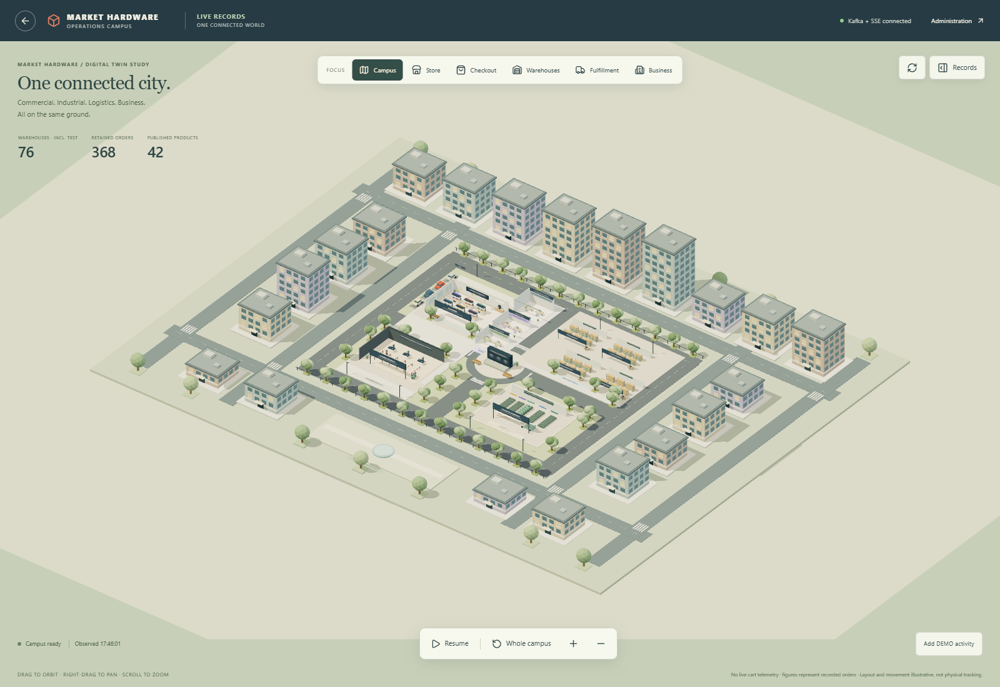

# 3D business world (desktop)

Branch: `3d-test-branch`. LIVE route: **`/admin/3d-world`**. The original synthetic demo remains at `/admin/3d-store`.

From the initialized project root:

```powershell
powershell -NoProfile -ExecutionPolicy Bypass -File .\scripts\start-world.ps1
cd frontend
npm ci
npm run dev
```

Open http://127.0.0.1:5173/admin/3d-world and use your existing administrator account. For the existing Docker frontend, pass `-WithFrontend` and open http://localhost:8080/admin/3d-world.

The world is one continuous pastel low-poly miniature city, with **Commercial, Industrial, Logistics and Business** districts. Click a building or use Focus to move smoothly into its cutaway interior; all facilities share one ground plane and one persistent canvas. Orbit with left drag, pan with right drag, zoom with the wheel, and reset with Whole campus. Pause freezes movement, not API reads.

The world reads real local warehouse/stock, order, payment, catalogue, analytics and optional monitoring records. Kafka/SSE invalidates snapshots; existing APIs remain authoritative. Layouts and routes are illustrative. It cannot change business data. **Add DEMO activity** enables simulated shoppers, outdoor pedestrians and delivery vans; they never represent actual visitors or shipments. Unavailable monitoring and stale analytics are labeled explicitly. The original standalone DEMO remains available. Desktop PC browsers at 1280px+ only.

See [architecture, cold-start steps, event flow, configuration, verification and limits](../docs/3d-world.md). Start/verify commands preserve existing volumes, credentials, offsets and checkpoints. A full empty-volume cold start remains unverified.

The surrounding city quarter adds 21 decorative procedural buildings, window grids, rooftops, connected streets and a small park. It takes general visual inspiration from [Gaurav-Gosain/city](https://github.com/Gaurav-Gosain/city). No upstream code or models were copied: the inspected repository did not provide a reuse license. Surrounding buildings are synthetic scenery, not additional business facilities. Existing clickable operational interiors and API/Kafka behavior remain unchanged. For this visual follow-up, tests were skipped as requested; only the production build was run.


